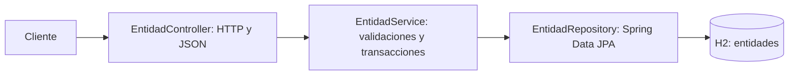
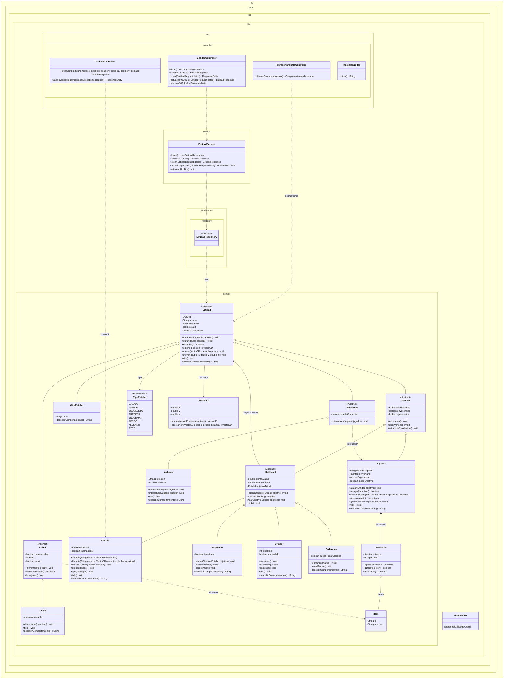

# st-taller-git-2026

-Nombre: Sofia Torres
-Github: Sofia-torres00
-Comision: CYT646 F 

## OpenAPI y Swagger UI

El proyecto usa el puerto 8081. Requiere Java 21; `JAVA_HOME` debe apuntar al JDK
21 tambien al ejecutar Maven. Iniciar una sola instancia desde PowerShell:

```powershell
.\mvnw.cmd spring-boot:run
```

Para detenerla y liberar el archivo de H2, usar `Ctrl+C` en esa terminal.

- **Swagger UI:** http://localhost:8081/swagger-ui.html
- **OpenAPI JSON:** http://localhost:8081/v3/api-docs
- **OpenAPI YAML:** http://localhost:8081/v3/api-docs.yaml

Swagger UI permite consultar y probar todos los endpoints: inicio, entidades,
explosiones, combates integrados, objetos externos, zombies, comportamientos y sonidos. Cada operacion
incluye su descripcion, parametros, esquemas de entrada/salida y codigos HTTP.
Los ejemplos de explosion usan UUID ilustrativos: reemplazarlos por IDs de
entidades creadas con `POST /api/entidades`.

La integracion usa `springdoc-openapi-starter-webmvc-ui` 2.10.0, compatible con
Spring Boot 3.5 segun la [documentacion de springdoc](https://springdoc.org/v2/faq.html#what-is-the-compatibility-matrix-of-springdoc-openapi-with-spring-boot).
La configuracion general esta en `OpenApiConfig`; las rutas y el orden de la UI
se configuran mediante propiedades `springdoc` en `application.properties`.

## Demolicion coordinada: Sofi + Nico + Amir

`POST /api/demoliciones` implementa el escenario aprobado para el trio:

1. Sofi consulta `GET /api/minecraft/explosivos/{id}` de Nico y exige una respuesta
   valida con `puedeExplotar=true`. Un rechazo o error detiene el flujo.
2. Sofi envia a Amir `POST /api/lp3/explosiones/simular` con unicamente
   `{"creeperId": ...}`. Amir valida y aplica su explosion sobre sus entidades.
3. Con HTTP 200 y una confirmacion valida de Amir, Sofi guarda el resultado en la
   tabla H2 `demoliciones` y responde HTTP 201 con la ubicacion del registro.

```json
{
  "explosivoNicoId": "b26bb20b-a15f-43ed-b4a9-f2c19480516e",
  "creeperAmirId": 25
}
```

Los IDs son independientes y deben existir en sus respectivos servidores. Los
del ejemplo se comprobaron mediante GET; su disponibilidad puede cambiar. Esta
operacion aplica dano real en Amir y elimina su Creeper. La consulta de Nico no
detona su explosivo.

- `GET /api/demoliciones`: historial local ordenado del mas reciente al mas antiguo.
- `GET /api/demoliciones/{id}`: resultado guardado por su UUID de Sofi.

```properties
nico.base-url=http://100.83.179.97:8080
nico.timeout=5s
minecraft-remoto.base-url=http://100.78.121.31:8080
minecraft-remoto.timeout=5s
```

Contratos utilizados, sin copiar codigo de los companeros:
[Nico](http://100.83.179.97:8080/v3/api-docs) y
[Amir](http://100.78.121.31:8080/v3/api-docs). Las copias consultadas estan en
[`docs/contracts/nico-openapi.json`](docs/contracts/nico-openapi.json) y
[`docs/contracts/amir-openapi.json`](docs/contracts/amir-openapi.json).

HTTP 400 indica datos invalidos; 404, una entidad o registro inexistente; 409,
un rechazo de negocio; 502, un error HTTP o de contrato externo; 504, un timeout.
Solo se guardan operaciones confirmadas: los rechazos y resultados inciertos no
crean registros. Los clientes no reintentan automaticamente la detonacion.

No hay una transaccion distribuida entre Amir y H2. Si Amir no responde o devuelve
una respuesta no confirmable, su explosion puede haberse aplicado: consultar su
estado antes de repetir. Si Amir confirma y luego falla el registro local, Sofi
devuelve HTTP 503 indicando ese resultado; no revierte la explosion ni la repite.

## Diagrama de integraciones

Para importar los endpoints en Insomnia, usar **Import > File** y seleccionar
[`docs/minecraft-openapi.json`](docs/minecraft-openapi.json). El archivo incluye
los 15 endpoints, ejemplos de solicitudes y las integraciones con Nico y Amir;
incluye los servidores `http://100.79.75.27:8081` y `http://localhost:8081`.
Reiniciar la aplicacion despues de actualizar el
codigo para que los endpoints nuevos esten disponibles. Los IDs de participantes
del ejemplo de explosion deben reemplazarse por IDs existentes de los tipos
correspondientes.

El [diagrama de integraciones](docs/integraciones.md) muestra las llamadas entre
el proyecto de Sofia, el proyecto Minecraft de **Amir** y la API de objetos,
con las reglas que aporta cada uno y sus endpoints de referencia.

## Combate integrado con el proyecto Minecraft de Amir

`POST /api/combates/integrados` combina las reglas locales de ataque con la
demostracion `GET /entidad/{tipo}?danio=...` del
[proyecto de Amir](http://100.78.121.31:8080/swagger-ui/index.html).
El contrato consultado esta en su [OpenAPI](http://100.78.121.31:8080/v3/api-docs).

1. Busca el atacante por su UUID local y exige que sea un `MobHostil` vivo.
2. Reutiliza `calcularDanioAtaque()`, el mismo calculo que usa `atacarObjetivo`:
   Zombie = 4; Esqueleto con arco = 4, sin arco = 2; Enderman = 7; Creeper = 0.
   La explosion del Creeper sigue siendo una operacion distinta.
3. Multiplica el danio por los golpes indicados (1 a 100; por defecto 1).
4. Consulta la entidad temporal remota con WebClient. El otro proyecto ejecuta
   su comportamiento y aplica sus reglas de recibir danio, vida final y muerte.
5. Devuelve el calculo local junto con el estado remoto y los drops si murio.

La operacion no modifica entidades persistidas de ninguno de los proyectos.
El endpoint remoto de demostracion puede ejecutar efectos del comportamiento:
por ejemplo, el Creeper temporal explota antes de recibir el danio solicitado.

Ejemplo con el Zombie1 existente (si se elimina, reemplazar el UUID):

```json
{
  "atacanteId": "11111111-1111-1111-1111-111111111111",
  "tipoObjetivo": "ZOMBIE",
  "golpes": 5
}
```

El Zombie local envia 20 de danio: 5 golpes de 4. El Zombie temporal remoto
termina con vida 0 y suelta `carne_podrida`. Tambien se admiten como objetivos
`ESQUELETO`, `LOBO`, `OVEJA`, `ALDEANO` y `CREEPER`.

```powershell
Invoke-RestMethod -Method Post -Uri 'http://localhost:8081/api/combates/integrados' -ContentType 'application/json' -Body '{"atacanteId":"11111111-1111-1111-1111-111111111111","tipoObjetivo":"ZOMBIE","golpes":5}'
```

```properties
minecraft-remoto.base-url=http://100.78.121.31:8080
minecraft-remoto.timeout=5s
```

HTTP 400 indica datos invalidos o un atacante no hostil; 404, un UUID local
inexistente; 409, un atacante muerto o danio incompatible con el contrato remoto;
502, un fallo HTTP, de conexion o de respuesta remota; 504, tiempo de espera
agotado. El servidor remoto debe ser accesible desde la red de la aplicacion.

## Consulta de objetos con WebClient

`GET /api/objetos` consulta `https://api.restful-api.dev/objects` mediante
`ObjetoService` y devuelve la lista de objetos con los campos `id`, `name` y
`data`. El campo `data` admite propiedades variables y valores nulos.

```powershell
Invoke-RestMethod -Method Get -Uri 'http://localhost:8081/api/objetos'
```

La URL base y el tiempo limite se configuran en `application.properties`:

```properties
restful-api.base-url=https://api.restful-api.dev
restful-api.timeout=10s
```

El controlador devuelve HTTP 502 si falla la conexion o la API externa responde
con un error HTTP, y HTTP 504 si se supera el tiempo limite. La consulta usa
`Mono` sin bloquear el hilo del controlador y no guarda los objetos en H2.

## Regla de negocio: simulación de explosiones

La operación recibe los identificadores de tres participantes: un `Creeper`,
un `Jugador` y un `Cerdo`. El creeper debe estar vivo y los tres registros deben
existir, ser distintos y pertenecer a las clases indicadas. La regla se ejecuta
en `ExplosionService`: aplica daño al jugador y al cerdo si están vivos y a
menos de 6 bloques del creeper. El daño máximo es 20 y disminuye con la distancia:

```text
daño = 20 × (1 - distancia / 6), cuando distancia < 6
salud final = máximo(0, salud anterior - daño)
```

Es una regla simplificada para este proyecto. En el límite de 6 bloques y
fuera del radio no se aplica daño. El creeper queda con salud y `fuseTime` en
cero y se apaga. Un creeper muerto no puede volver a detonar. La operación
solo modifica a los tres participantes seleccionados.

Participan estas tres clases concretas del modelo:

| Clase | Participación |
| --- | --- |
| `Creeper` | Determina el origen de la explosión y consume su salud |
| `Jugador` | Recibe daño según su distancia al origen |
| `Cerdo` | También recibe daño; su salud puede llegar a cero |

El servicio calcula la distancia usando las coordenadas X, Y y Z de la ubicación
de cada participante. Usa `tomarDanio`, heredado de `Entidad`, para reducir la
salud sin valores negativos.

El endpoint es **`POST /api/explosiones`**, con este cuerpo JSON:

```json
{
  "creeperId": "UUID_DEL_CREEPER",
  "jugadorId": "UUID_DEL_JUGADOR",
  "cerdoId": "UUID_DEL_CERDO"
}
```

`ExplosionController` recibe la solicitud y delega en `ExplosionService`.
`EntidadRepository` obtiene y bloquea solamente los tres participantes.
JPA confirma juntos sus cambios en H2. La respuesta `ExplosionResponse` incluye
el origen, el radio, la salud final del creeper y `resultados` con la distancia,
el daño realmente aplicado, la salud anterior y la salud final del jugador y
del cerdo, incluso cuando estén fuera del radio o ya estuvieran muertos.

| HTTP | Resultado |
| --- | --- |
| 200 | Explosión realizada con los tres participantes |
| 400 | Faltan IDs, están repetidos, son inválidos o los tipos no corresponden |
| 404 | Alguno de los participantes no existe |
| 409 | El creeper está muerto y no puede explotar |

### Probar la explosión desde PowerShell

Con la versión actualizada de la aplicación ejecutándose, crear un creeper,
un jugador a 1.5 bloques y un cerdo a 3 bloques. Se usa un centro en X=1000
para separar el ejemplo de los personajes creados anteriormente cerca de X=0:

```powershell
$base = 'http://localhost:8081'
$creeper = Invoke-RestMethod -Method Post -Uri "$base/api/entidades" -ContentType 'application/json' -Body '{"nombre":"CreeperDemo","tipo":"CREEPER","salud":20,"ubicacion":{"x":1000,"y":64,"z":0}}'
$jugador = Invoke-RestMethod -Method Post -Uri "$base/api/entidades" -ContentType 'application/json' -Body '{"nombre":"JugadorDemo","tipo":"JUGADOR","salud":20,"ubicacion":{"x":1001.5,"y":64,"z":0}}'
$cerdo = Invoke-RestMethod -Method Post -Uri "$base/api/entidades" -ContentType 'application/json' -Body '{"nombre":"CerdoDemo","tipo":"CERDO","salud":10,"ubicacion":{"x":1003,"y":64,"z":0}}'

$solicitud = @{ creeperId = $creeper.id; jugadorId = $jugador.id; cerdoId = $cerdo.id } | ConvertTo-Json
$solicitud | curl.exe -i -X POST "$base/api/explosiones" -H 'Content-Type: application/json' --data-binary '@-'
```

El resultado esperado es salud 0 para `CreeperDemo`, 5 para `JugadorDemo` y
0 para `CerdoDemo`. Otros registros permanecen sin cambios. Repetir el último
comando con los mismos IDs devuelve 409.

Para comprobar los cambios en H2:

```sql
SELECT DTYPE, ID, NOMBRE, SALUD, X, Y, Z
FROM ENTIDADES
WHERE NOMBRE IN ('CreeperDemo', 'JugadorDemo', 'CerdoDemo');
```

Las pruebas cubren las tres clases, el daño a distintas distancias, la salud
mínima cero, participantes muertos o fuera del radio, validación de los tres
IDs y sus tipos, registros no seleccionados, rollback y solicitudes concurrentes.

## CRUD REST de Entidad

El CRUD sigue esta arquitectura de tres capas:



- **Presentación:** `rest/controller/EntidadController.java` recibe las peticiones
  y delega en el servicio. `EntidadExceptionHandler` traduce errores a HTTP.
- **Negocios:** `service/EntidadService.java` valida los datos antes de guardar
  o actualizar. Usa transacciones para las escrituras.
- **Persistencia:** `persistence/repository/EntidadRepository.java` extiende
  `JpaRepository<Entidad, UUID>`. Spring Data implementa el acceso a H2.

`domain/Entidad` es una entidad JPA abstracta con
`@Inheritance(strategy = InheritanceType.SINGLE_TABLE)`. Las clases intermedias
y las subclases también llevan `@Entity`. Toda la jerarquía se guarda en
`ENTIDADES`; la columna `DTYPE` identifica la clase concreta: `Zombie`, `Creeper`,
`Esqueleto`, `Enderman`, `Cerdo`, `Aldeano`, `Jugador` u `OtraEntidad`.
Los atributos particulares ocupan columnas de esa misma tabla y quedan en
`NULL` cuando no corresponden al personaje. No se usa un modelo JPA separado.
La estrategia se describe en la
[documentación de Hibernate](https://docs.hibernate.org/orm/6.6/introduction/html_single/).

`Vector3D` es `@Embeddable` y ocupa las columnas `X`, `Y` y `Z`.
El inventario del jugador también se mapea con `@Embedded`; sus items se guardan
en `INVENTARIO_ITEMS` mediante `@ElementCollection`, conservando su orden.
`MobHostil.objetivoActual` es una relación `@ManyToOne` con otra entidad; al
eliminar un objetivo, el servicio desvincula los mobs que lo estaban siguiendo.

Las entidades y los valores embebidos tienen constructores protegidos sin
argumentos para JPA. Los DTO de `dto/` definen el JSON de entrada y salida y
evitan serializar directamente relaciones del dominio. Los UUID se generan en
los constructores del dominio, en el servidor.

| Método | Ruta | Resultado |
| --- | --- | --- |
| POST | `/api/entidades` | Crear: 201 y cabecera `Location` |
| GET | `/api/entidades` | Listar: 200, lista vacía si no hay registros |
| GET | `/api/entidades/{id}` | Obtener: 200 o 404 |
| PUT | `/api/entidades/{id}` | Reemplazar los datos: 200 o 404 |
| DELETE | `/api/entidades/{id}` | Eliminar: 204 o 404 |

Para crear una entidad, enviar este JSON con `Content-Type: application/json` a
`POST http://localhost:8081/api/entidades`. Para actualizar, enviar los mismos
campos a `PUT /api/entidades/{id}` con el UUID devuelto al crearla:

```json
{
  "nombre": "Zombie1",
  "tipo": "ZOMBIE",
  "salud": 20,
  "ubicacion": { "x": 0, "y": 64, "z": 0 },
  "atributos": { "velocidad": 3 }
}
```

Ejemplo en PowerShell, con la aplicación en ejecución:

```powershell
$base = 'http://localhost:8081/api/entidades'
$datos = '{"nombre":"Zombie1","tipo":"ZOMBIE","salud":20,"ubicacion":{"x":0,"y":64,"z":0}}'
$entidad = Invoke-RestMethod -Method Post -Uri $base -ContentType 'application/json' -Body $datos
Invoke-RestMethod -Uri $base
Invoke-RestMethod -Uri "$base/$($entidad.id)"
Invoke-RestMethod -Method Put -Uri "$base/$($entidad.id)" -ContentType 'application/json' -Body ($datos.Replace('20', '15'))
Invoke-RestMethod -Method Delete -Uri "$base/$($entidad.id)"
```

El servicio exige un nombre no vacío de hasta 100 caracteres (quita espacios de
los extremos), un tipo, salud finita mayor o igual a cero, y una ubicación con
las tres coordenadas finitas. Los tipos válidos son `JUGADOR`, `ZOMBIE`,
`ESQUELETO`, `CREEPER`, `ENDERMAN`, `CERDO`, `ALDEANO` y `OTRO`.
Datos inválidos, JSON incorrecto o un UUID mal formado devuelven 400 con
`{"error":"mensaje"}`. Un UUID válido que no exista devuelve 404.

`atributos` es opcional: los cuerpos anteriores sin ese campo siguen funcionando.
Cada tipo admite los siguientes atributos de creación y actualización:

| Tipo | Atributos y valores iniciales si se omiten al crear |
| --- | --- |
| ZOMBIE | `velocidad`: 1.5, finita y no negativa |
| CREEPER | `fuseTime`: 30, mayor que cero |
| ESQUELETO | `tieneArco`: true |
| ENDERMAN | `puedeTomarBloques`: true |
| CERDO | `montable`: false; `edad`: 0, no negativa |
| ALDEANO | `profesion`: "Granjero", de 1 a 255 caracteres; `nivelComercio`: 1, entre 1 y 5 |
| JUGADOR | `capacidadInventario`: 36, mayor que cero; `modoCreativo`: false |
| OTRO | Sin atributos específicos |

En una actualización, los atributos específicos omitidos conservan su valor.
La respuesta incluye `atributos` con los datos específicos y el estado heredado
del personaje. La salud de un `SerVivo` no puede superar su `saludMaxima` (20 por
defecto o 40 para Enderman). Un `PUT` no permite cambiar el tipo de personaje
ni la capacidad de un inventario existente. Los errores posteriores a un cambio
de datos revierten toda la transacción.

### Base de datos y pruebas

La aplicación usa `jdbc:h2:file:./data/entidades`: los datos se conservan entre
reinicios si se ejecuta desde la misma carpeta. Hibernate crea o actualiza la
tabla `entidades`. Los archivos de `data/` están excluidos de Git.

Antes de que arranque Hibernate, `db/upgrade-entidades.sql` prepara la tabla y
adapta automáticamente los registros del CRUD anterior. Conserva sus UUID,
nombres, tipos, salud y coordenadas, y completa los atributos nuevos con valores
iniciales según la subclase. Si una salud anterior supera el máximo habitual,
ese valor se conserva y se usa como máximo para esa entidad. El script solo
inicializa filas sin `DTYPE`; los reinicios no sobrescriben el estado de los
personajes. No hace falta borrar la base de datos.

Después de reiniciar la aplicación, se puede comprobar la herencia desde H2:

```sql
SELECT DTYPE, ID, NOMBRE, TIPO, SALUD, VELOCIDAD, FUERZA_ATAQUE, MONTABLE, X, Y, Z
FROM ENTIDADES;
```

La consola de desarrollo está en `http://localhost:8081/h2-console`:

- JDBC URL: `jdbc:h2:file:./data/entidades`
- Usuario: `sa`
- Contraseña: vacía

Con JDK 21 seleccionado, ejecutar:

```powershell
.\mvnw.cmd test
.\mvnw.cmd spring-boot:run
```

Las pruebas usan bases H2 en memoria independientes y comprueban el CRUD,
las validaciones del servicio, las respuestas 400/404, la reconstrucción de las
ocho subclases tras limpiar el contexto JPA, el inventario, la relación al
objetivo y la migración de una tabla con el esquema anterior.
Los endpoints anteriores (`/`, `/api/zombie`, `/api/comportamientos` y
`/api/sonidos`) siguen disponibles.

## Levantar la API

Requiere JDK 21. `JAVA_HOME` debe apuntar al JDK 21 y su carpeta `bin` debe estar
en `PATH`. El Wrapper descarga la versión de Maven indicada en
`.mvn/wrapper/maven-wrapper.properties`; no hace falta Maven global.

```sh
java -version
./mvnw -v
./mvnw clean compile
./mvnw spring-boot:run
```

En PowerShell, usar `./mvnw.cmd` en lugar de `./mvnw`. Para seleccionar el JDK
solo en esa terminal (ajustar la ruta a la instalación local):

```powershell
$env:JAVA_HOME = 'C:\Program Files\Eclipse Adoptium\jdk-21.0.12.101-hotspot'
$env:PATH = "$env:JAVA_HOME\bin;$env:PATH"
```

## Diagrama de clases



## POO-06 — 30/09/2026

El dominio está en `src/main/java/py/edu/uc/lp3/domain`
(package `py.edu.uc.lp3.domain`). Los controllers están
en `rest/controller` (package `py.edu.uc.lp3.rest.controller`).
`Application` está en `src/main/java/py/edu/uc/lp3/Application.java`, package
`py.edu.uc.lp3`, y solo arranca Spring Boot. Spring detecta los controllers bajo
ese paquete raíz. El diagrama incluye el CRUD de Entidad, sus capas y la
jerarquía de dominio, con sus paquetes y relaciones de herencia.

Se agregó la **sobrecarga** `Entidad.mover(double x, double y, double z)`, que
construye un `Vector3D` y delega en `mover(Vector3D nuevaUbicacion)`. Es la misma
acción con distintas listas de argumentos; la validación sigue en el dominio.

`Zombie` también tiene dos constructores: `Zombie(String, Vector3D)` utiliza
velocidad 1.5 y delega en `Zombie(String, Vector3D, double)`, que llama a `super(...)`
y valida la velocidad. Ambas firmas construyen objetos válidos con entradas válidas,
sin setters públicos.

La **sobreescritura** ya existe en `Zombie` y `Creeper`: ambas implementan
`describirComportamiento()` declarado abstracto en `Entidad`, con la misma firma y
comportamientos distintos. `ComportamientoController` las trata como `Entidad`.
La sobrecarga cambia los argumentos; la sobreescritura cambia la implementación
heredada, seleccionada según el tipo real del objeto.

### Ejemplos REST

- `GET /`: presentación de la API.
- `GET /api/zombie?nombre=Zombie1&x=0&y=64&z=0&velocidad=1.5`: construye un zombie con parámetros de URL.
- `GET /api/comportamientos`: JSON con el comportamiento de un zombie y un creeper.

Las reglas de nombre, coordenadas y velocidad se validan en `Entidad`, `Vector3D`
y `Zombie`, respectivamente. `ZombieController` convierte las
`IllegalArgumentException` del dominio en HTTP 400 con JSON `{"error":"mensaje"}`,
sin duplicar esas reglas. Una velocidad negativa devuelve 400; una válida, 200.
