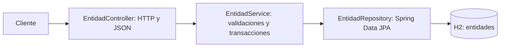
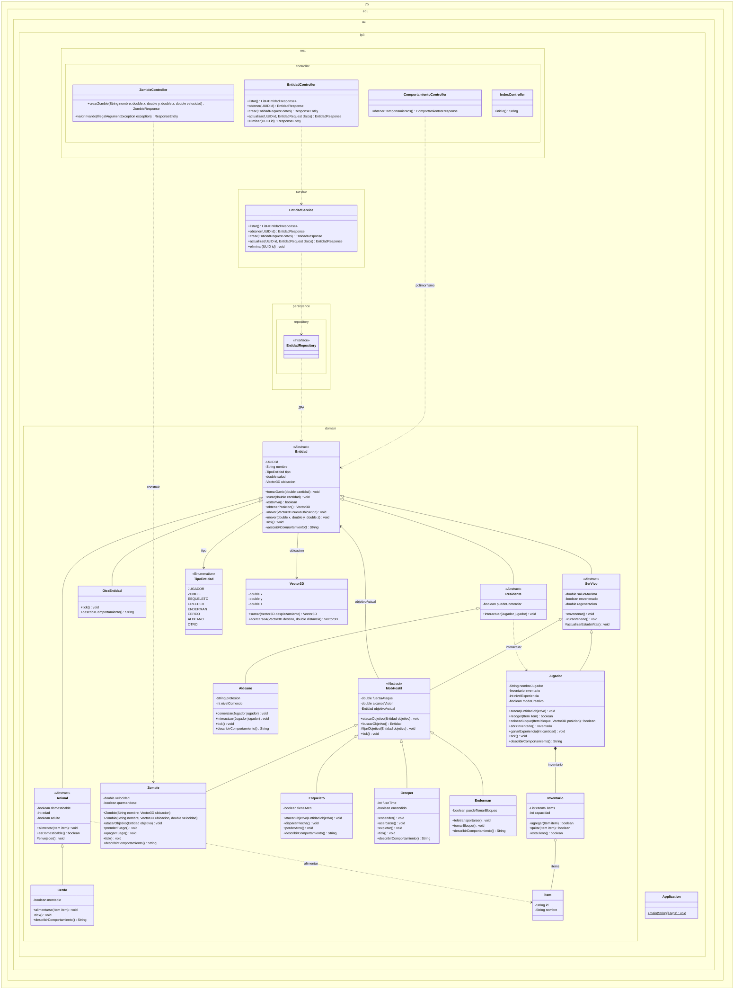

# st-taller-git-2026

-Nombre: Sofia Torres
-Github: Sofia-torres00
-Comision: CYT646 F 

## Regla de negocio: simulación de explosiones

La operación recibe los identificadores de tres participantes: un `Creeper`,
un `Jugador` y un `Cerdo`. El creeper debe estar vivo y los tres registros deben
existir, ser distintos y pertenecer a las clases indicadas. La regla se ejecuta
en `ExplosionService`: aplica daño al jugador y al cerdo si están vivos y a
menos de 6 bloques del creeper. El daño máximo es 20 y disminuye con la distancia:

```text
daño = 20 × (1 - distancia / 6), cuando distancia < 6
salud final = máximo(0, salud anterior - daño)
```

Es una regla simplificada para este proyecto. En el límite de 6 bloques y
fuera del radio no se aplica daño. El creeper queda con salud y `fuseTime` en
cero y se apaga. Un creeper muerto no puede volver a detonar. La operación
solo modifica a los tres participantes seleccionados.

Participan estas tres clases concretas del modelo:

| Clase | Participación |
| --- | --- |
| `Creeper` | Determina el origen de la explosión y consume su salud |
| `Jugador` | Recibe daño según su distancia al origen |
| `Cerdo` | También recibe daño; su salud puede llegar a cero |

El servicio calcula la distancia usando las coordenadas X, Y y Z de la ubicación
de cada participante. Usa `tomarDanio`, heredado de `Entidad`, para reducir la
salud sin valores negativos.

El endpoint es **`POST /api/explosiones`**, con este cuerpo JSON:

```json
{
  "creeperId": "UUID_DEL_CREEPER",
  "jugadorId": "UUID_DEL_JUGADOR",
  "cerdoId": "UUID_DEL_CERDO"
}
```

`ExplosionController` recibe la solicitud y delega en `ExplosionService`.
`EntidadRepository` obtiene y bloquea solamente los tres participantes.
JPA confirma juntos sus cambios en H2. La respuesta `ExplosionResponse` incluye
el origen, el radio, la salud final del creeper y `resultados` con la distancia,
el daño realmente aplicado, la salud anterior y la salud final del jugador y
del cerdo, incluso cuando estén fuera del radio o ya estuvieran muertos.

| HTTP | Resultado |
| --- | --- |
| 200 | Explosión realizada con los tres participantes |
| 400 | Faltan IDs, están repetidos, son inválidos o los tipos no corresponden |
| 404 | Alguno de los participantes no existe |
| 409 | El creeper está muerto y no puede explotar |

### Probar la explosión desde PowerShell

Con la versión actualizada de la aplicación ejecutándose, crear un creeper,
un jugador a 1.5 bloques y un cerdo a 3 bloques. Se usa un centro en X=1000
para separar el ejemplo de los personajes creados anteriormente cerca de X=0:

```powershell
$base = 'http://localhost:8080'
$creeper = Invoke-RestMethod -Method Post -Uri "$base/api/entidades" -ContentType 'application/json' -Body '{"nombre":"CreeperDemo","tipo":"CREEPER","salud":20,"ubicacion":{"x":1000,"y":64,"z":0}}'
$jugador = Invoke-RestMethod -Method Post -Uri "$base/api/entidades" -ContentType 'application/json' -Body '{"nombre":"JugadorDemo","tipo":"JUGADOR","salud":20,"ubicacion":{"x":1001.5,"y":64,"z":0}}'
$cerdo = Invoke-RestMethod -Method Post -Uri "$base/api/entidades" -ContentType 'application/json' -Body '{"nombre":"CerdoDemo","tipo":"CERDO","salud":10,"ubicacion":{"x":1003,"y":64,"z":0}}'

$solicitud = @{ creeperId = $creeper.id; jugadorId = $jugador.id; cerdoId = $cerdo.id } | ConvertTo-Json
$solicitud | curl.exe -i -X POST "$base/api/explosiones" -H 'Content-Type: application/json' --data-binary '@-'
```

El resultado esperado es salud 0 para `CreeperDemo`, 5 para `JugadorDemo` y
0 para `CerdoDemo`. Otros registros permanecen sin cambios. Repetir el último
comando con los mismos IDs devuelve 409.

Para comprobar los cambios en H2:

```sql
SELECT DTYPE, ID, NOMBRE, SALUD, X, Y, Z
FROM ENTIDADES
WHERE NOMBRE IN ('CreeperDemo', 'JugadorDemo', 'CerdoDemo');
```

Las pruebas cubren las tres clases, el daño a distintas distancias, la salud
mínima cero, participantes muertos o fuera del radio, validación de los tres
IDs y sus tipos, registros no seleccionados, rollback y solicitudes concurrentes.

## CRUD REST de Entidad

El CRUD sigue esta arquitectura de tres capas:



- **Presentación:** `rest/controller/EntidadController.java` recibe las peticiones
  y delega en el servicio. `EntidadExceptionHandler` traduce errores a HTTP.
- **Negocios:** `service/EntidadService.java` valida los datos antes de guardar
  o actualizar. Usa transacciones para las escrituras.
- **Persistencia:** `persistence/repository/EntidadRepository.java` extiende
  `JpaRepository<Entidad, UUID>`. Spring Data implementa el acceso a H2.

`domain/Entidad` es una entidad JPA abstracta con
`@Inheritance(strategy = InheritanceType.SINGLE_TABLE)`. Las clases intermedias
y las subclases también llevan `@Entity`. Toda la jerarquía se guarda en
`ENTIDADES`; la columna `DTYPE` identifica la clase concreta: `Zombie`, `Creeper`,
`Esqueleto`, `Enderman`, `Cerdo`, `Aldeano`, `Jugador` u `OtraEntidad`.
Los atributos particulares ocupan columnas de esa misma tabla y quedan en
`NULL` cuando no corresponden al personaje. No se usa un modelo JPA separado.
La estrategia se describe en la
[documentación de Hibernate](https://docs.hibernate.org/orm/6.6/introduction/html_single/).

`Vector3D` es `@Embeddable` y ocupa las columnas `X`, `Y` y `Z`.
El inventario del jugador también se mapea con `@Embedded`; sus items se guardan
en `INVENTARIO_ITEMS` mediante `@ElementCollection`, conservando su orden.
`MobHostil.objetivoActual` es una relación `@ManyToOne` con otra entidad; al
eliminar un objetivo, el servicio desvincula los mobs que lo estaban siguiendo.

Las entidades y los valores embebidos tienen constructores protegidos sin
argumentos para JPA. Los DTO de `dto/` definen el JSON de entrada y salida y
evitan serializar directamente relaciones del dominio. Los UUID se generan en
los constructores del dominio, en el servidor.

| Método | Ruta | Resultado |
| --- | --- | --- |
| POST | `/api/entidades` | Crear: 201 y cabecera `Location` |
| GET | `/api/entidades` | Listar: 200, lista vacía si no hay registros |
| GET | `/api/entidades/{id}` | Obtener: 200 o 404 |
| PUT | `/api/entidades/{id}` | Reemplazar los datos: 200 o 404 |
| DELETE | `/api/entidades/{id}` | Eliminar: 204 o 404 |

Para crear una entidad, enviar este JSON con `Content-Type: application/json` a
`POST http://localhost:8080/api/entidades`. Para actualizar, enviar los mismos
campos a `PUT /api/entidades/{id}` con el UUID devuelto al crearla:

```json
{
  "nombre": "Zombie1",
  "tipo": "ZOMBIE",
  "salud": 20,
  "ubicacion": { "x": 0, "y": 64, "z": 0 },
  "atributos": { "velocidad": 3 }
}
```

Ejemplo en PowerShell, con la aplicación en ejecución:

```powershell
$base = 'http://localhost:8080/api/entidades'
$datos = '{"nombre":"Zombie1","tipo":"ZOMBIE","salud":20,"ubicacion":{"x":0,"y":64,"z":0}}'
$entidad = Invoke-RestMethod -Method Post -Uri $base -ContentType 'application/json' -Body $datos
Invoke-RestMethod -Uri $base
Invoke-RestMethod -Uri "$base/$($entidad.id)"
Invoke-RestMethod -Method Put -Uri "$base/$($entidad.id)" -ContentType 'application/json' -Body ($datos.Replace('20', '15'))
Invoke-RestMethod -Method Delete -Uri "$base/$($entidad.id)"
```

El servicio exige un nombre no vacío de hasta 100 caracteres (quita espacios de
los extremos), un tipo, salud finita mayor o igual a cero, y una ubicación con
las tres coordenadas finitas. Los tipos válidos son `JUGADOR`, `ZOMBIE`,
`ESQUELETO`, `CREEPER`, `ENDERMAN`, `CERDO`, `ALDEANO` y `OTRO`.
Datos inválidos, JSON incorrecto o un UUID mal formado devuelven 400 con
`{"error":"mensaje"}`. Un UUID válido que no exista devuelve 404.

`atributos` es opcional: los cuerpos anteriores sin ese campo siguen funcionando.
Cada tipo admite los siguientes atributos de creación y actualización:

| Tipo | Atributos y valores iniciales si se omiten al crear |
| --- | --- |
| ZOMBIE | `velocidad`: 1.5, finita y no negativa |
| CREEPER | `fuseTime`: 30, mayor que cero |
| ESQUELETO | `tieneArco`: true |
| ENDERMAN | `puedeTomarBloques`: true |
| CERDO | `montable`: false; `edad`: 0, no negativa |
| ALDEANO | `profesion`: "Granjero", de 1 a 255 caracteres; `nivelComercio`: 1, entre 1 y 5 |
| JUGADOR | `capacidadInventario`: 36, mayor que cero; `modoCreativo`: false |
| OTRO | Sin atributos específicos |

En una actualización, los atributos específicos omitidos conservan su valor.
La respuesta incluye `atributos` con los datos específicos y el estado heredado
del personaje. La salud de un `SerVivo` no puede superar su `saludMaxima` (20 por
defecto o 40 para Enderman). Un `PUT` no permite cambiar el tipo de personaje
ni la capacidad de un inventario existente. Los errores posteriores a un cambio
de datos revierten toda la transacción.

### Base de datos y pruebas

La aplicación usa `jdbc:h2:file:./data/entidades`: los datos se conservan entre
reinicios si se ejecuta desde la misma carpeta. Hibernate crea o actualiza la
tabla `entidades`. Los archivos de `data/` están excluidos de Git.

Antes de que arranque Hibernate, `db/upgrade-entidades.sql` prepara la tabla y
adapta automáticamente los registros del CRUD anterior. Conserva sus UUID,
nombres, tipos, salud y coordenadas, y completa los atributos nuevos con valores
iniciales según la subclase. Si una salud anterior supera el máximo habitual,
ese valor se conserva y se usa como máximo para esa entidad. El script solo
inicializa filas sin `DTYPE`; los reinicios no sobrescriben el estado de los
personajes. No hace falta borrar la base de datos.

Después de reiniciar la aplicación, se puede comprobar la herencia desde H2:

```sql
SELECT DTYPE, ID, NOMBRE, TIPO, SALUD, VELOCIDAD, FUERZA_ATAQUE, MONTABLE, X, Y, Z
FROM ENTIDADES;
```

La consola de desarrollo está en `http://localhost:8080/h2-console`:

- JDBC URL: `jdbc:h2:file:./data/entidades`
- Usuario: `sa`
- Contraseña: vacía

Con JDK 21 seleccionado, ejecutar:

```powershell
.\mvnw.cmd test
.\mvnw.cmd spring-boot:run
```

Las pruebas usan bases H2 en memoria independientes y comprueban el CRUD,
las validaciones del servicio, las respuestas 400/404, la reconstrucción de las
ocho subclases tras limpiar el contexto JPA, el inventario, la relación al
objetivo y la migración de una tabla con el esquema anterior.
Los endpoints anteriores (`/`, `/api/zombie`, `/api/comportamientos` y
`/api/sonidos`) siguen disponibles.

## Levantar la API

Requiere JDK 21. `JAVA_HOME` debe apuntar al JDK 21 y su carpeta `bin` debe estar
en `PATH`. El Wrapper descarga la versión de Maven indicada en
`.mvn/wrapper/maven-wrapper.properties`; no hace falta Maven global.

```sh
java -version
./mvnw -v
./mvnw clean compile
./mvnw spring-boot:run
```

En PowerShell, usar `./mvnw.cmd` en lugar de `./mvnw`. Para seleccionar el JDK
solo en esa terminal (ajustar la ruta a la instalación local):

```powershell
$env:JAVA_HOME = 'C:\Program Files\Eclipse Adoptium\jdk-21.0.12.101-hotspot'
$env:PATH = "$env:JAVA_HOME\bin;$env:PATH"
```

## Diagrama de clases



## POO-06 — 30/09/2026

El dominio está en `src/main/java/py/edu/uc/lp3/domain`
(package `py.edu.uc.lp3.domain`). Los controllers están
en `rest/controller` (package `py.edu.uc.lp3.rest.controller`).
`Application` está en `src/main/java/py/edu/uc/lp3/Application.java`, package
`py.edu.uc.lp3`, y solo arranca Spring Boot. Spring detecta los controllers bajo
ese paquete raíz. El diagrama incluye el CRUD de Entidad, sus capas y la
jerarquía de dominio, con sus paquetes y relaciones de herencia.

Se agregó la **sobrecarga** `Entidad.mover(double x, double y, double z)`, que
construye un `Vector3D` y delega en `mover(Vector3D nuevaUbicacion)`. Es la misma
acción con distintas listas de argumentos; la validación sigue en el dominio.

`Zombie` también tiene dos constructores: `Zombie(String, Vector3D)` utiliza
velocidad 1.5 y delega en `Zombie(String, Vector3D, double)`, que llama a `super(...)`
y valida la velocidad. Ambas firmas construyen objetos válidos con entradas válidas,
sin setters públicos.

La **sobreescritura** ya existe en `Zombie` y `Creeper`: ambas implementan
`describirComportamiento()` declarado abstracto en `Entidad`, con la misma firma y
comportamientos distintos. `ComportamientoController` las trata como `Entidad`.
La sobrecarga cambia los argumentos; la sobreescritura cambia la implementación
heredada, seleccionada según el tipo real del objeto.

### Ejemplos REST

- `GET /`: presentación de la API.
- `GET /api/zombie?nombre=Zombie1&x=0&y=64&z=0&velocidad=1.5`: construye un zombie con parámetros de URL.
- `GET /api/comportamientos`: JSON con el comportamiento de un zombie y un creeper.

Las reglas de nombre, coordenadas y velocidad se validan en `Entidad`, `Vector3D`
y `Zombie`, respectivamente. `ZombieController` convierte las
`IllegalArgumentException` del dominio en HTTP 400 con JSON `{"error":"mensaje"}`,
sin duplicar esas reglas. Una velocidad negativa devuelve 400; una válida, 200.
