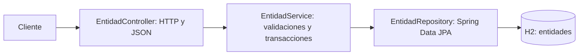
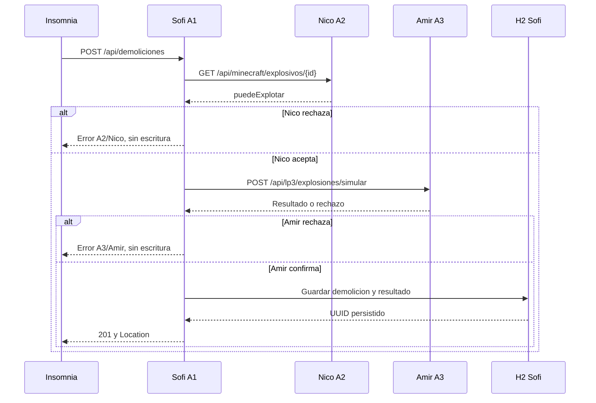

# st-taller-git-2026

-Nombre: Sofia Torres
-Github: Sofia-torres00
-Comision: CYT646 F 

## OpenAPI y Swagger UI

El proyecto usa el puerto 8081. Requiere Java 21; `JAVA_HOME` debe apuntar al JDK
21 tambien al ejecutar Maven. Iniciar una sola instancia desde PowerShell:

```powershell
.\mvnw.cmd spring-boot:run
```

Para detenerla y liberar el archivo de H2, usar `Ctrl+C` en esa terminal.

- **Swagger UI:** http://localhost:8081/swagger-ui.html
- **OpenAPI JSON:** http://localhost:8081/v3/api-docs
- **OpenAPI YAML:** http://localhost:8081/v3/api-docs.yaml

Swagger UI permite consultar y probar todos los endpoints: inicio, entidades,
explosiones, combates integrados, objetos externos, zombies, comportamientos y sonidos. Cada operacion
incluye su descripcion, parametros, esquemas de entrada/salida y codigos HTTP.
Los ejemplos de explosion usan UUID ilustrativos: reemplazarlos por IDs de
entidades creadas con `POST /api/entidades`.

La integracion usa `springdoc-openapi-starter-webmvc-ui` 2.10.0, compatible con
Spring Boot 3.5 segun la [documentacion de springdoc](https://springdoc.org/v2/faq.html#what-is-the-compatibility-matrix-of-springdoc-openapi-with-spring-boot).
La configuracion general esta en `OpenApiConfig`; las rutas y el orden de la UI
se configuran mediante propiedades `springdoc` en `application.properties`.

## Validacion de explosion para Amir: sin efectos secundarios

`POST /api/explosiones/validar` recibe el mismo `ExplosionRequest` que
`POST /api/explosiones` y reutiliza sus validaciones compartidas en
`ExplosionService`: UUID distintos, participantes existentes de tipo Creeper,
Jugador y Cerdo, y Creeper vivo. El controller solo delega en el servicio.

```json
{
  "creeperId": "UUID_DEL_CREEPER",
  "jugadorId": "UUID_DEL_JUGADOR",
  "cerdoId": "UUID_DEL_CERDO"
}
```

Con `Content-Type: application/json`, una aprobacion devuelve HTTP 200:

```json
{
  "aceptada": true,
  "creeperId": "UUID_DEL_CREEPER",
  "jugadorId": "UUID_DEL_JUGADOR",
  "cerdoId": "UUID_DEL_CERDO"
}
```

La operacion usa una transaccion `readOnly` y una consulta sin bloqueo de
escritura. No aplica dano, no consume al Creeper, no altera su encendido ni su
fuseTime, no elimina entidades, no guarda historial y no llama a Amir ni a Nico.
Las consultas repetidas conservan H2. La aprobacion describe el estado actual;
no reserva una explosion futura frente a cambios concurrentes.

La regla actual no exige que el jugador o el cerdo esten vivos ni dentro del
radio. La distancia determina el dano al ejecutar, no la aprobacion.

| HTTP | Motivo | Ejemplo del cuerpo de error |
| --- | --- | --- |
| 400 | JSON/UUID invalidos o campos ausentes | `{"error":"Debe indicar creeperId, jugadorId y cerdoId"}` para un objeto JSON sin participantes |
| 400 | Participantes repetidos | `{"error":"Las tres entidades deben tener identificadores distintos"}` |
| 400 | Tipo incorrecto | `{"error":"La entidad UUID debe ser de tipo Creeper"}` |
| 404 | Participante inexistente | `{"error":"No existe una entidad con id UUID"}` |
| 409 | Creeper muerto | `{"error":"Un creeper muerto no puede explotar"}` |

Un JSON malformado o un UUID que no se puede deserializar conserva el mensaje
existente `{"error":"JSON inválido: revise los campos y el tipo de entidad"}`.
OpenAPI y Swagger UI incluyen los esquemas y ejemplos completos. Los casos con
UUID reales para compartir estan en [casos-validacion-amir.json](docs/casos-validacion-amir.json).

`POST /api/explosiones` conserva el bloqueo transaccional y sus efectos. Las
demoliciones y el resto de endpoints permanecen independientes de esta consulta.

## Demolicion coordinada: Sofi + Nico + Amir

`POST /api/demoliciones` implementa el escenario aprobado para el trio:

1. Sofi consulta `GET /api/minecraft/explosivos/{id}` de Nico y exige una respuesta
   valida con `puedeExplotar=true`. Un rechazo o error detiene el flujo.
2. Sofi envia a Amir `POST /api/lp3/explosiones/simular` con unicamente
   `{"creeperId": ...}`. Amir valida y aplica su explosion sobre sus entidades.
3. Con HTTP 200 y una confirmacion valida de Amir, Sofi guarda el resultado en la
   tabla H2 `demoliciones` y responde HTTP 201 con la ubicacion del registro.

```json
{
  "explosivoNicoId": "b26bb20b-a15f-43ed-b4a9-f2c19480516e",
  "creeperAmirId": 25
}
```

Los IDs son independientes y deben existir en sus respectivos servidores. Los
del ejemplo se comprobaron mediante GET; su disponibilidad puede cambiar. Esta
operacion aplica dano real en Amir y elimina su Creeper. La consulta de Nico no
detona su explosivo.

- `GET /api/demoliciones`: historial local ordenado del mas reciente al mas antiguo.
- `GET /api/demoliciones/{id}`: resultado guardado por su UUID de Sofi.

```properties
nico.base-url=http://100.83.179.97:8080
nico.timeout=5s
minecraft-remoto.base-url=http://100.78.121.31:8080
minecraft-remoto.timeout=5s
```

Contratos utilizados, sin copiar codigo de los companeros:
[Nico](http://100.83.179.97:8080/v3/api-docs) y
[Amir](http://100.78.121.31:8080/v3/api-docs). Las copias consultadas estan en
[`docs/contracts/nico-openapi.json`](docs/contracts/nico-openapi.json) y
[`docs/contracts/amir-openapi.json`](docs/contracts/amir-openapi.json).

HTTP 400 indica datos invalidos; 404, una entidad o registro inexistente; 409,
un rechazo de negocio; 502, un error HTTP o de contrato externo; 504, un timeout.
Solo se guardan operaciones confirmadas: los rechazos y resultados inciertos no
crean registros. Los clientes no reintentan automaticamente la detonacion.

No hay una transaccion distribuida entre Amir y H2. Si Amir no responde o devuelve
una respuesta no confirmable, su explosion puede haberse aplicado: consultar su
estado antes de repetir. Si Amir confirma y luego falla el registro local, Sofi
devuelve HTTP 503 indicando ese resultado; no revierte la explosion ni la repite.

## Diagrama de integraciones

Para importar los endpoints en Insomnia, usar **Import > File** y seleccionar
[`docs/minecraft-openapi.json`](docs/minecraft-openapi.json). El archivo incluye
los 16 endpoints, ejemplos de solicitudes y las integraciones con Nico y Amir;
incluye los servidores `http://100.79.75.27:8081` y `http://localhost:8081`.
Reiniciar la aplicacion despues de actualizar el
codigo para que los endpoints nuevos esten disponibles. Los IDs de participantes
del ejemplo de explosion deben reemplazarse por IDs existentes de los tipos
correspondientes.

El [diagrama de integraciones](docs/integraciones.md) muestra las llamadas entre
el proyecto de Sofia, el proyecto Minecraft de **Amir** y la API de objetos,
con las reglas que aporta cada uno y sus endpoints de referencia.

## Combate integrado con el proyecto Minecraft de Amir

`POST /api/combates/integrados` combina las reglas locales de ataque con la
demostracion `GET /entidad/{tipo}?danio=...` del
[proyecto de Amir](http://100.78.121.31:8080/swagger-ui/index.html).
El contrato consultado esta en su [OpenAPI](http://100.78.121.31:8080/v3/api-docs).

1. Busca el atacante por su UUID local y exige que sea un `MobHostil` vivo.
2. Reutiliza `calcularDanioAtaque()`, el mismo calculo que usa `atacarObjetivo`:
   Zombie = 4; Esqueleto con arco = 4, sin arco = 2; Enderman = 7; Creeper = 0.
   La explosion del Creeper sigue siendo una operacion distinta.
3. Multiplica el danio por los golpes indicados (1 a 100; por defecto 1).
4. Consulta la entidad temporal remota con WebClient. El otro proyecto ejecuta
   su comportamiento y aplica sus reglas de recibir danio, vida final y muerte.
5. Devuelve el calculo local junto con el estado remoto y los drops si murio.

La operacion no modifica entidades persistidas de ninguno de los proyectos.
El endpoint remoto de demostracion puede ejecutar efectos del comportamiento:
por ejemplo, el Creeper temporal explota antes de recibir el danio solicitado.

Ejemplo con el Zombie1 existente (si se elimina, reemplazar el UUID):

```json
{
  "atacanteId": "11111111-1111-1111-1111-111111111111",
  "tipoObjetivo": "ZOMBIE",
  "golpes": 5
}
```

El Zombie local envia 20 de danio: 5 golpes de 4. El Zombie temporal remoto
termina con vida 0 y suelta `carne_podrida`. Tambien se admiten como objetivos
`ESQUELETO`, `LOBO`, `OVEJA`, `ALDEANO` y `CREEPER`.

```powershell
Invoke-RestMethod -Method Post -Uri 'http://localhost:8081/api/combates/integrados' -ContentType 'application/json' -Body '{"atacanteId":"11111111-1111-1111-1111-111111111111","tipoObjetivo":"ZOMBIE","golpes":5}'
```

```properties
minecraft-remoto.base-url=http://100.78.121.31:8080
minecraft-remoto.timeout=5s
```

HTTP 400 indica datos invalidos o un atacante no hostil; 404, un UUID local
inexistente; 409, un atacante muerto o danio incompatible con el contrato remoto;
502, un fallo HTTP, de conexion o de respuesta remota; 504, tiempo de espera
agotado. El servidor remoto debe ser accesible desde la red de la aplicacion.

## Consulta de objetos con WebClient

`GET /api/objetos` consulta `https://api.restful-api.dev/objects` mediante
`ObjetoService` y devuelve la lista de objetos con los campos `id`, `name` y
`data`. El campo `data` admite propiedades variables y valores nulos.

```powershell
Invoke-RestMethod -Method Get -Uri 'http://localhost:8081/api/objetos'
```

La URL base y el tiempo limite se configuran en `application.properties`:

```properties
restful-api.base-url=https://api.restful-api.dev
restful-api.timeout=10s
```

El controlador devuelve HTTP 502 si falla la conexion o la API externa responde
con un error HTTP, y HTTP 504 si se supera el tiempo limite. La consulta usa
`Mono` sin bloquear el hilo del controlador y no guarda los objetos en H2.

## Regla de negocio: simulación de explosiones

La operación recibe los identificadores de tres participantes: un `Creeper`,
un `Jugador` y un `Cerdo`. El creeper debe estar vivo y los tres registros deben
existir, ser distintos y pertenecer a las clases indicadas. La regla se ejecuta
en `ExplosionService`: aplica daño al jugador y al cerdo si están vivos y a
menos de 6 bloques del creeper. El daño máximo es 20 y disminuye con la distancia:

```text
daño = 20 × (1 - distancia / 6), cuando distancia < 6
salud final = máximo(0, salud anterior - daño)
```

Es una regla simplificada para este proyecto. En el límite de 6 bloques y
fuera del radio no se aplica daño. El creeper queda con salud y `fuseTime` en
cero y se apaga. Un creeper muerto no puede volver a detonar. La operación
solo modifica a los tres participantes seleccionados.

Participan estas tres clases concretas del modelo:

| Clase | Participación |
| --- | --- |
| `Creeper` | Determina el origen de la explosión y consume su salud |
| `Jugador` | Recibe daño según su distancia al origen |
| `Cerdo` | También recibe daño; su salud puede llegar a cero |

El servicio calcula la distancia usando las coordenadas X, Y y Z de la ubicación
de cada participante. Usa `tomarDanio`, heredado de `Entidad`, para reducir la
salud sin valores negativos.

El endpoint es **`POST /api/explosiones`**, con este cuerpo JSON:

```json
{
  "creeperId": "UUID_DEL_CREEPER",
  "jugadorId": "UUID_DEL_JUGADOR",
  "cerdoId": "UUID_DEL_CERDO"
}
```

`ExplosionController` recibe la solicitud y delega en `ExplosionService`.
`EntidadRepository` obtiene y bloquea solamente los tres participantes.
JPA confirma juntos sus cambios en H2. La respuesta `ExplosionResponse` incluye
el origen, el radio, la salud final del creeper y `resultados` con la distancia,
el daño realmente aplicado, la salud anterior y la salud final del jugador y
del cerdo, incluso cuando estén fuera del radio o ya estuvieran muertos.

| HTTP | Resultado |
| --- | --- |
| 200 | Explosión realizada con los tres participantes |
| 400 | Faltan IDs, están repetidos, son inválidos o los tipos no corresponden |
| 404 | Alguno de los participantes no existe |
| 409 | El creeper está muerto y no puede explotar |

### Probar la explosión desde PowerShell

Con la versión actualizada de la aplicación ejecutándose, crear un creeper,
un jugador a 1.5 bloques y un cerdo a 3 bloques. Se usa un centro en X=1000
para separar el ejemplo de los personajes creados anteriormente cerca de X=0:

```powershell
$base = 'http://localhost:8081'
$creeper = Invoke-RestMethod -Method Post -Uri "$base/api/entidades" -ContentType 'application/json' -Body '{"nombre":"CreeperDemo","tipo":"CREEPER","salud":20,"ubicacion":{"x":1000,"y":64,"z":0}}'
$jugador = Invoke-RestMethod -Method Post -Uri "$base/api/entidades" -ContentType 'application/json' -Body '{"nombre":"JugadorDemo","tipo":"JUGADOR","salud":20,"ubicacion":{"x":1001.5,"y":64,"z":0}}'
$cerdo = Invoke-RestMethod -Method Post -Uri "$base/api/entidades" -ContentType 'application/json' -Body '{"nombre":"CerdoDemo","tipo":"CERDO","salud":10,"ubicacion":{"x":1003,"y":64,"z":0}}'

$solicitud = @{ creeperId = $creeper.id; jugadorId = $jugador.id; cerdoId = $cerdo.id } | ConvertTo-Json
$solicitud | curl.exe -i -X POST "$base/api/explosiones" -H 'Content-Type: application/json' --data-binary '@-'
```

El resultado esperado es salud 0 para `CreeperDemo`, 5 para `JugadorDemo` y
0 para `CerdoDemo`. Otros registros permanecen sin cambios. Repetir el último
comando con los mismos IDs devuelve 409.

Para comprobar los cambios en H2:

```sql
SELECT DTYPE, ID, NOMBRE, SALUD, X, Y, Z
FROM ENTIDADES
WHERE NOMBRE IN ('CreeperDemo', 'JugadorDemo', 'CerdoDemo');
```

Las pruebas cubren las tres clases, el daño a distintas distancias, la salud
mínima cero, participantes muertos o fuera del radio, validación de los tres
IDs y sus tipos, registros no seleccionados, rollback y solicitudes concurrentes.

## CRUD REST de Entidad

El CRUD sigue esta arquitectura de tres capas:



- **Presentación:** `rest/controller/EntidadController.java` recibe las peticiones
  y delega en el servicio. `EntidadExceptionHandler` traduce errores a HTTP.
- **Negocios:** `service/EntidadService.java` valida los datos antes de guardar
  o actualizar. Usa transacciones para las escrituras.
- **Persistencia:** `persistence/repository/EntidadRepository.java` extiende
  `JpaRepository<Entidad, UUID>`. Spring Data implementa el acceso a H2.

`domain/Entidad` es una entidad JPA abstracta con
`@Inheritance(strategy = InheritanceType.SINGLE_TABLE)`. Las clases intermedias
y las subclases también llevan `@Entity`. Toda la jerarquía se guarda en
`ENTIDADES`; la columna `DTYPE` identifica la clase concreta: `Zombie`, `Creeper`,
`Esqueleto`, `Enderman`, `Cerdo`, `Aldeano`, `Jugador` u `OtraEntidad`.
Los atributos particulares ocupan columnas de esa misma tabla y quedan en
`NULL` cuando no corresponden al personaje. No se usa un modelo JPA separado.
La estrategia se describe en la
[documentación de Hibernate](https://docs.hibernate.org/orm/6.6/introduction/html_single/).

`Vector3D` es `@Embeddable` y ocupa las columnas `X`, `Y` y `Z`.
El inventario del jugador también se mapea con `@Embedded`; sus items se guardan
en `INVENTARIO_ITEMS` mediante `@ElementCollection`, conservando su orden.
`MobHostil.objetivoActual` es una relación `@ManyToOne` con otra entidad; al
eliminar un objetivo, el servicio desvincula los mobs que lo estaban siguiendo.

Las entidades y los valores embebidos tienen constructores protegidos sin
argumentos para JPA. Los DTO de `dto/` definen el JSON de entrada y salida y
evitan serializar directamente relaciones del dominio. Los UUID se generan en
los constructores del dominio, en el servidor.

| Método | Ruta | Resultado |
| --- | --- | --- |
| POST | `/api/entidades` | Crear: 201 y cabecera `Location` |
| GET | `/api/entidades` | Listar: 200, lista vacía si no hay registros |
| GET | `/api/entidades/{id}` | Obtener: 200 o 404 |
| PUT | `/api/entidades/{id}` | Reemplazar los datos: 200 o 404 |
| DELETE | `/api/entidades/{id}` | Eliminar: 204 o 404 |

Para crear una entidad, enviar este JSON con `Content-Type: application/json` a
`POST http://localhost:8081/api/entidades`. Para actualizar, enviar los mismos
campos a `PUT /api/entidades/{id}` con el UUID devuelto al crearla:

```json
{
  "nombre": "Zombie1",
  "tipo": "ZOMBIE",
  "salud": 20,
  "ubicacion": { "x": 0, "y": 64, "z": 0 },
  "atributos": { "velocidad": 3 }
}
```

Ejemplo en PowerShell, con la aplicación en ejecución:

```powershell
$base = 'http://localhost:8081/api/entidades'
$datos = '{"nombre":"Zombie1","tipo":"ZOMBIE","salud":20,"ubicacion":{"x":0,"y":64,"z":0}}'
$entidad = Invoke-RestMethod -Method Post -Uri $base -ContentType 'application/json' -Body $datos
Invoke-RestMethod -Uri $base
Invoke-RestMethod -Uri "$base/$($entidad.id)"
Invoke-RestMethod -Method Put -Uri "$base/$($entidad.id)" -ContentType 'application/json' -Body ($datos.Replace('20', '15'))
Invoke-RestMethod -Method Delete -Uri "$base/$($entidad.id)"
```

El servicio exige un nombre no vacío de hasta 100 caracteres (quita espacios de
los extremos), un tipo, salud finita mayor o igual a cero, y una ubicación con
las tres coordenadas finitas. Los tipos válidos son `JUGADOR`, `ZOMBIE`,
`ESQUELETO`, `CREEPER`, `ENDERMAN`, `CERDO`, `ALDEANO` y `OTRO`.
Datos inválidos, JSON incorrecto o un UUID mal formado devuelven 400 con
`{"error":"mensaje"}`. Un UUID válido que no exista devuelve 404.

`atributos` es opcional: los cuerpos anteriores sin ese campo siguen funcionando.
Cada tipo admite los siguientes atributos de creación y actualización:

| Tipo | Atributos y valores iniciales si se omiten al crear |
| --- | --- |
| ZOMBIE | `velocidad`: 1.5, finita y no negativa |
| CREEPER | `fuseTime`: 30, mayor que cero |
| ESQUELETO | `tieneArco`: true |
| ENDERMAN | `puedeTomarBloques`: true |
| CERDO | `montable`: false; `edad`: 0, no negativa |
| ALDEANO | `profesion`: "Granjero", de 1 a 255 caracteres; `nivelComercio`: 1, entre 1 y 5 |
| JUGADOR | `capacidadInventario`: 36, mayor que cero; `modoCreativo`: false |
| OTRO | Sin atributos específicos |

En una actualización, los atributos específicos omitidos conservan su valor.
La respuesta incluye `atributos` con los datos específicos y el estado heredado
del personaje. La salud de un `SerVivo` no puede superar su `saludMaxima` (20 por
defecto o 40 para Enderman). Un `PUT` no permite cambiar el tipo de personaje
ni la capacidad de un inventario existente. Los errores posteriores a un cambio
de datos revierten toda la transacción.

### Base de datos y pruebas

La aplicación usa `jdbc:h2:file:./data/entidades`: los datos se conservan entre
reinicios si se ejecuta desde la misma carpeta. Hibernate crea o actualiza la
tabla `entidades`. Los archivos de `data/` están excluidos de Git.

Antes de que arranque Hibernate, `db/upgrade-entidades.sql` prepara la tabla y
adapta automáticamente los registros del CRUD anterior. Conserva sus UUID,
nombres, tipos, salud y coordenadas, y completa los atributos nuevos con valores
iniciales según la subclase. Si una salud anterior supera el máximo habitual,
ese valor se conserva y se usa como máximo para esa entidad. El script solo
inicializa filas sin `DTYPE`; los reinicios no sobrescriben el estado de los
personajes. No hace falta borrar la base de datos.

Después de reiniciar la aplicación, se puede comprobar la herencia desde H2:

```sql
SELECT DTYPE, ID, NOMBRE, TIPO, SALUD, VELOCIDAD, FUERZA_ATAQUE, MONTABLE, X, Y, Z
FROM ENTIDADES;
```

La consola de desarrollo está en `http://localhost:8081/h2-console`:

- JDBC URL: `jdbc:h2:file:./data/entidades`
- Usuario: `sa`
- Contraseña: vacía

Con JDK 21 seleccionado, ejecutar:

```powershell
.\mvnw.cmd test
.\mvnw.cmd spring-boot:run
```

Las pruebas usan bases H2 en memoria independientes y comprueban el CRUD,
las validaciones del servicio, las respuestas 400/404, la reconstrucción de las
ocho subclases tras limpiar el contexto JPA, el inventario, la relación al
objetivo y la migración de una tabla con el esquema anterior.
Los endpoints anteriores (`/`, `/api/zombie`, `/api/comportamientos` y
`/api/sonidos`) siguen disponibles.

## Levantar la API

Requiere JDK 21. `JAVA_HOME` debe apuntar al JDK 21 y su carpeta `bin` debe estar
en `PATH`. El Wrapper descarga la versión de Maven indicada en
`.mvn/wrapper/maven-wrapper.properties`; no hace falta Maven global.

```sh
java -version
./mvnw -v
./mvnw clean compile
./mvnw spring-boot:run
```

En PowerShell, usar `./mvnw.cmd` en lugar de `./mvnw`. Para seleccionar el JDK
solo en esa terminal (ajustar la ruta a la instalación local):

```powershell
$env:JAVA_HOME = 'C:\Program Files\Eclipse Adoptium\jdk-21.0.12.101-hotspot'
$env:PATH = "$env:JAVA_HOME\bin;$env:PATH"
```

## Diagrama de clases


## POO-06 — 30/09/2026

El dominio está en `src/main/java/py/edu/uc/lp3/domain`
(package `py.edu.uc.lp3.domain`). Los controllers están
en `rest/controller` (package `py.edu.uc.lp3.rest.controller`).
`Application` está en `src/main/java/py/edu/uc/lp3/Application.java`, package
`py.edu.uc.lp3`, y solo arranca Spring Boot. Spring detecta los controllers bajo
ese paquete raíz. El diagrama incluye el CRUD de Entidad, sus capas y la
jerarquía de dominio, con sus paquetes y relaciones de herencia.

Se agregó la **sobrecarga** `Entidad.mover(double x, double y, double z)`, que
construye un `Vector3D` y delega en `mover(Vector3D nuevaUbicacion)`. Es la misma
acción con distintas listas de argumentos; la validación sigue en el dominio.

`Zombie` también tiene dos constructores: `Zombie(String, Vector3D)` utiliza
velocidad 1.5 y delega en `Zombie(String, Vector3D, double)`, que llama a `super(...)`
y valida la velocidad. Ambas firmas construyen objetos válidos con entradas válidas,
sin setters públicos.

La **sobreescritura** ya existe en `Zombie` y `Creeper`: ambas implementan
`describirComportamiento()` declarado abstracto en `Entidad`, con la misma firma y
comportamientos distintos. `ComportamientoController` las trata como `Entidad`.
La sobrecarga cambia los argumentos; la sobreescritura cambia la implementación
heredada, seleccionada según el tipo real del objeto.

### Ejemplos REST

- `GET /`: presentación de la API.
- `GET /api/zombie?nombre=Zombie1&x=0&y=64&z=0&velocidad=1.5`: construye un zombie con parámetros de URL.
- `GET /api/comportamientos`: JSON con el comportamiento de un zombie y un creeper.

Las reglas de nombre, coordenadas y velocidad se validan en `Entidad`, `Vector3D`
y `Zombie`, respectivamente. `ZombieController` convierte las
`IllegalArgumentException` del dominio en HTTP 400 con JSON `{"error":"mensaje"}`,
sin duplicar esas reglas. Una velocidad negativa devuelve 400; una válida, 200.

## POO-09: entrega del trio (23/11/2026)

**Escenario propio:** Sofi registra una demolicion ejecutada por Amir solamente
si Nico confirma que existe un explosivo de respaldo disponible.

| Rol | Alumno | Repositorio | Commit acordado | Base URL | OpenAPI | Regla consumida |
| --- | --- | --- | --- | --- | --- | --- |
| A1 | Sofi | [Repositorio Sofi](https://github.com/Sofia-torres00/st-taller-git-2026) | [06a6fb297a5e9f9186d23b6dee7086fdaba94e30](https://github.com/Sofia-torres00/st-taller-git-2026/commit/06a6fb297a5e9f9186d23b6dee7086fdaba94e30) | http://100.79.75.27:8081 | [OpenAPI Sofi](http://100.79.75.27:8081/v3/api-docs) | Escenario propio: demolicion coordinada con respaldo disponible |
| A2 | Nico | [Repositorio Nico](https://github.com/NicoRodriguez85677/NRodriguez-taller-git-2026) | [e9db16a93c925928734932e2759459a08747a1dd](https://github.com/NicoRodriguez85677/NRodriguez-taller-git-2026/commit/e9db16a93c925928734932e2759459a08747a1dd) | http://100.83.179.97:8080 | [OpenAPI Nico](http://100.83.179.97:8080/v3/api-docs) | Consultar si un mob puede explotar |
| A3 | Amir | [Repositorio Amir](https://github.com/AmirDujak/adb-taller-git-2026) | [a6e6b14a3626f1cf6cfa48547fb4b1d5596a03fb](https://github.com/AmirDujak/adb-taller-git-2026/commit/a6e6b14a3626f1cf6cfa48547fb4b1d5596a03fb) | http://100.78.121.31:8080 | [OpenAPI Amir](http://100.78.121.31:8080/v3/api-docs) | Simular y aplicar una explosion |

Estos roles corresponden a la entrega de Sofi. Cada alumno es A1 en su propia
entrega: en la de Amir, Amir es A1, Sofi es A2 y Nico es A3.

### Evidencia documental del round robin

**Round robin: completo documentalmente.** Amir registra en su
[README del commit acordado](https://github.com/AmirDujak/adb-taller-git-2026/blob/a6e6b14a3626f1cf6cfa48547fb4b1d5596a03fb/README.md)
que consume `POST /api/explosiones/validar` de Sofi como su validacion A2.
Nuestra operacion comprueba un Creeper, un Jugador y un Cerdo: exige tres UUID
distintos, verifica que existan y tengan los tipos correctos y requiere que el
Creeper este vivo. Solo evalua esas condiciones; no aplica dano, no modifica H2
ni consume al Creeper.

Esta evidencia acredita el mapa y la documentacion del consumo entre
integrantes. El consumo A2/A3 desde el A1 de Sofi esta implementado y probado;
la **demostracion coordinada en vivo sigue pendiente de ejecucion**. Son estados
distintos: no se trata de un requisito de codigo faltante. Las pruebas HTTP en
vivo requieren acceso a Tailscale y los servicios de los companeros encendidos.

### Dos participantes independientes

El explosivo de Nico representa el **respaldo**: su consulta debe confirmar
`puedeExplotar=true`. El Creeper de Amir representa el **ejecutor**: aporta la
explosion que se registra. En la demostracion ambos son Creepers, pero no son
copias sincronizadas ni identificadores intercambiables: Nico usa UUID y Amir
usa Long. La politica de Sofi exige disponer del respaldo antes de ejecutar.
El codigo admite cualquier Explosivo valido de Nico, sin agregar una restriccion
nueva de subtipo. No se consume ni se reserva el respaldo; la consulta es una
fotografia de disponibilidad, sin garantia frente a cambios concurrentes.

Sofi necesita a Nico para autorizar esa disponibilidad y a Amir para confirmar
la ejecucion. Orden: Nico, Amir, persistencia local. En `demoliciones` guarda
UUID propio, ambos IDs remotos, fecha y resultado JSON de Amir. No copia
entidades ajenas a su tabla `entidades`.

### Rechazos y efectos reales

Los contratos reales consultados el 23/11/2026 describen:

- Nico: `GET /api/minecraft/explosivos/{id}` es de lectura, sin detonacion.
- Amir: `POST /api/lp3/explosiones/simular` aplica dano, modifica supervivientes,
  elimina muertos y consume el Creeper. No es una validacion de lectura.
- Amir tambien publica `POST /api/lp3/explosiones/previsualizar-integrada`, sin
  efectos, pero exige `creeperId`, `jugadorExternoId` y `cerdoExternoId` y depende
  de otro servicio externo. No reemplaza directamente el contrato actual de un
  solo `creeperId`: hacerlo cambiaria el escenario aprobado. Conviene pedir a
  Amir una validacion separada compatible con ese cuerpo si se requiere una
  autorizacion sin ejecutar. No se afirma que esa variante ya exista.

Si Nico rechaza, no se llama a Amir. Si Amir rechaza, no se registra una
operacion. Ambos dejan iguales entidades, salud, inventarios e historial H2 de
Sofi, comprobado con snapshots SQL completos en las pruebas.

```json
{"fuente":"A2","servicio":"Nico","mensaje":"Nico indica que el explosivo no puede explotar","status":409}
```

```json
{"fuente":"A3","servicio":"Amir","mensaje":"Amir no confirmo la explosion (HTTP 409); verifique su estado antes de repetir","status":409}
```

El campo `status` coincide con el HTTP publico: 404/409 para rechazos remotos,
502 para fallos de conexion/contrato y 504 para timeout. Una entrada local
invalida conserva 400 y `{"error":"..."}`. Los mensajes pueden variar segun
el rechazo. A1 garantiza que su propia H2 no cambia ante un rechazo.
Una operacion remota ya ejecutada no puede deshacerse mediante
la transaccion local de A1. Esta es una limitacion del flujo entre servicios,
no un bug corregido ni una garantia de rollback remoto.
Un timeout puede ocurrir despues
de una detonacion; comprobar el estado en Amir antes de repetir. Una
confirmacion seguida de fallo de persistencia local devuelve 503. No hay
rollback distribuido ni reintentos automaticos de la detonacion.

### Referencias y arranque reproducible

La tabla identifica los commits acordados/publicados por el grupo. No se
clonaron ni ejecutaron esos commits ajenos durante esta revision; los hashes
no certifican la version de los procesos actualmente encendidos. El hash
acordado de Sofi identifica la base publicada, no incorpora automaticamente
los cambios locales posteriores que todavia requieren revision y commit.

Los comandos siguientes proceden de los README consultados previamente;
no constituyen una prueba de arranque de los nuevos hashes acordados.
Se requiere Maven Wrapper y Java 21. Ejecutar cada
bloque desde el repositorio correspondiente, en equipos separados y conectados
a Tailscale. Seleccionar JDK 21 en `JAVA_HOME` antes de Maven.

Sofi, puerto 8081:

```powershell
$env:NICO_BASE_URL = 'http://100.83.179.97:8080'
$env:MINECRAFT_REMOTO_BASE_URL = 'http://100.78.121.31:8080'
.\mvnw.cmd spring-boot:run
```

Spring permite sobrescribir `nico.base-url` y `minecraft-remoto.base-url` con
esas variables. Sus timeouts configurados son 5s.

Nico, puerto 8080 (variables documentadas en su README):

```powershell
$env:POO09_A2_URL = 'http://100.78.121.31:8080'
$env:POO09_A3_URL = 'http://100.79.75.27:8081'
.\mvnw.cmd spring-boot:run
```

Amir, puerto 8080 (su README usa `./mvnw`; en PowerShell usar `.\mvnw.cmd`):

```powershell
$env:SOFIA_API_BASE_URL = 'http://100.79.75.27:8081'
$env:NICOLAS_API_BASE_URL = 'http://100.83.179.97:8080'
.\mvnw.cmd spring-boot:run
```

Sofi consume las operaciones de dominio, nunca los orquestadores de sus
companeros. Cada integrante es A1 en su propia entrega. La referencia para que
Amir consuma nuestra validacion sigue siendo `/api/explosiones/validar` y
[los casos con UUID](docs/casos-validacion-amir.json); verificar que aun existan
antes de usarlos. Se elimino la referencia a un archivo de texto inexistente.

### Insomnia y demostracion

Importar **Import > File** y elegir
[sofi-poo09.yaml](docs/insomnia/sofi-poo09.yaml). Es la unica coleccion nativa
del escenario; el archivo OpenAPI anterior se conserva como contrato general.
Incluye las nueve solicitudes numeradas. Configurar las variables:

| Variable | Servicio | Valor del grupo |
| --- | --- | --- |
| `a1_base_url` | Sofi | `http://100.79.75.27:8081` |
| `a2_base_url` | Nico | `http://100.83.179.97:8080` |
| `a3_base_url` | Amir | `http://100.78.121.31:8080` |

El archivo fue validado estructuralmente.
La importación gráfica en Insomnia se verifica manualmente.
La validacion estructural utilizo el esquema oficial Insomnia 5.1; no se
ha confirmado todavia la importacion en la aplicacion.

Los ejemplos estan en la descripcion de cada solicitud y en
[ejemplos-poo09.json](docs/insomnia/ejemplos-poo09.json), disponibles offline.
Son respuestas capturadas de las pruebas: A1 real, A2/A3 simulados y H2 en
memoria. No se presentan como una demolicion ejecutada en los equipos del grupo
ni como historial nativo de respuestas de Insomnia.

Antes del caso feliz, coordinar con Amir un Creeper de prueba dedicado, apartado
de otras entidades, y copiar su ID en `amir_ejecutor_id`. El valor inicial 0
impide ejecutar accidentalmente un Creeper ajeno y devuelve 400 hasta cambiarlo.
Para crearlo, su contrato acepta `POST /api/lp3/entidades` con:

```json
{"tipo":"CREEPER","nombre":"POO09DemoSofi","vida":20,"danoBase":0,"velocidadMovimiento":0,"hitbox":{"ancho":0.6,"alto":1.7,"profundidad":0.6},"sonidos":[],"drop":[],"cargado":false,"posicion":{"x":20000,"y":64,"z":0}}
```

Confirmar primero con Amir que esa zona esta libre. En Nico comprobar por GET
que `nico_respaldo_id` devuelve `puedeExplotar=true` y `nico_rechazo_id` devuelve
false. Los UUID iniciales se consultaron previamente, pero pueden desaparecer.
Si hace falta un respaldo nuevo, su OpenAPI publica
`POST /api/minecraft/mobs/creepers` con
`{"x":20000,"y":64,"z":0,"tiempoDetonacion":3}`; copiar el UUID devuelto.
No usar un Creeper valido como caso de rechazo. `amir_rechazo_id` contiene un
Long positivo deliberadamente inexistente; comprobar su ausencia para obtener
404 atribuido a A3. Un Creeper ya consumido tambien produce 404. El ejemplo
offline A3 ilustra 409; ambos son rechazos validos identificados.

1. Levantar Sofi con la version revisada; una sola instancia sobre su H2.
2. Levantar Nico en su equipo.
3. Levantar Amir en su equipo.
4. Abrir los tres OpenAPI con solicitudes 01-03; preparar IDs y guardar una
   respuesta inicial de `GET /api/demoliciones` como linea base.
5. Ejecutar 04 una vez: esperar 201 con `id`, fecha, IDs y resultado de Amir.
6. Ejecutar 05: localizar el mismo UUID y resultado; consultar tambien
   `GET /api/demoliciones/{id}`. En H2 verificar
   `SELECT * FROM DEMOLICIONES WHERE ID = 'UUID_DEVUELTO';`.
   Esa respuesta completa es la nueva linea base; Amir consumio al ejecutor.
7. Ejecutar 06 con el respaldo rechazado: esperar 409 A2/Nico. No llega a Amir.
8. Ejecutar 07 y comparar toda la lista con 05: ningun dato local cambia.
9. Ejecutar 08 con respaldo valido e ID inexistente de Amir: esperar 404
   A3/Amir, sin registro nuevo.
10. Ejecutar 09: comparar toda la lista con 05/07. Para volver a ejecutar el
    caso feliz, crear otro ejecutor en Amir y actualizar la variable.



### Verificacion de este cierre

Resultado tecnico ya registrado de `.\mvnw.cmd clean test` con JDK 21:
**160 tests, 0 failures, 0 errors, 0 skipped**. Las pruebas cubren aprobacion
persistida, atribucion de rechazos y snapshots completos sin cambios locales.
No se volvieron a ejecutar tests para esta actualizacion exclusivamente documental.

| Criterio POO-09 | Estado | Evidencia |
| --- | --- | --- |
| OpenAPI | Completo | Contrato y Swagger de Sofi, con pruebas de documentacion |
| Round robin | Completo documentalmente | Mapa del grupo y consumo de la validacion de Sofi documentado por Amir |
| Consumo A2/A3 | Completo | Clientes Nico/Amir y flujo A2 -> A3 implementados y probados |
| Escenario persistido | Verificado en pruebas | Aprobacion guardada en H2 y consulta posterior; rechazos sin cambios locales |

Pendientes de evidencia, no de implementacion:

- Confirmar manualmente la importacion grafica en Insomnia.
- Ejecutar y registrar la demostracion coordinada en vivo con los tres servicios.

No se ejecuto una nueva detonacion real remota durante este cierre.
Esta actualizacion solo modifica documentacion. No se hicieron operaciones
git add, commit ni push.
