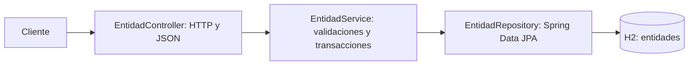

# st-taller-git-2026

-Nombre: Sofia Torres
-Github: Sofia-torres00
-Comision: CYT646 F 

Licencia: [Apache 2.0](LICENSE).

## Regla de negocio: simulación de explosiones

La operación recibe los identificadores de tres participantes: un `Creeper`,
un `Jugador` y un `Cerdo`. El creeper debe estar vivo y los tres registros deben
existir, ser distintos y pertenecer a las clases indicadas. `ExplosionService`
coordina las reglas del dominio: `Entidad.recibirExplosion` aplica daño al jugador y al cerdo si están vivos y a
menos de 6 bloques del creeper. El daño máximo es 20 y disminuye con la distancia:

```text
daño = 20 × (1 - distancia / 6), cuando distancia < 6
salud final = máximo(0, salud anterior - daño)
```

Es una regla simplificada para este proyecto. En el límite de 6 bloques y
fuera del radio no se aplica daño. El creeper queda con salud y `fuseTime` en
cero y se apaga. Un creeper muerto no puede volver a detonar. La operación
solo modifica a los tres participantes seleccionados.

Participan estas tres clases concretas del modelo:

| Clase | Participación |
| --- | --- |
| `Creeper` | Determina el origen de la explosión y consume su salud |
| `Jugador` | Recibe daño según su distancia al origen |
| `Cerdo` | También recibe daño; su salud puede llegar a cero |

El dominio calcula la distancia con `Vector3D.distanciaA`, usando las coordenadas
X, Y y Z. `Entidad.recibirExplosion` usa `tomarDanio` para reducir la salud sin
valores negativos. `Creeper.finalizarExplosion` consume al creeper y
`validarPuedeExplotar` rechaza una detonación de un creeper muerto.

El endpoint es **`POST /api/explosiones`**, con este cuerpo JSON:

```json
{
  "creeperId": "UUID_DEL_CREEPER",
  "jugadorId": "UUID_DEL_JUGADOR",
  "cerdoId": "UUID_DEL_CERDO"
}
```

`ExplosionController` recibe la solicitud y delega en `ExplosionService`.
`EntidadRepository` obtiene y bloquea solamente los tres participantes.
JPA confirma juntos sus cambios en H2. La respuesta `ExplosionResponse` incluye
el origen, el radio, la salud final del creeper y `resultados` con la distancia,
el daño realmente aplicado, la salud anterior y la salud final del jugador y
del cerdo, incluso cuando estén fuera del radio o ya estuvieran muertos.

| HTTP | Resultado |
| --- | --- |
| 200 | Explosión realizada con los tres participantes |
| 400 | Faltan IDs, están repetidos, son inválidos o los tipos no corresponden |
| 404 | Alguno de los participantes no existe |
| 409 | El creeper está muerto y no puede explotar |

### Probar la explosión desde PowerShell

Con la versión actualizada de la aplicación ejecutándose, crear un creeper,
un jugador a 1.5 bloques y un cerdo a 3 bloques. Se usa un centro en X=1000
para separar el ejemplo de los personajes creados anteriormente cerca de X=0:

```powershell
$base = 'http://localhost:8080'
$creeper = Invoke-RestMethod -Method Post -Uri "$base/api/entidades" -ContentType 'application/json' -Body '{"nombre":"CreeperDemo","tipo":"CREEPER","salud":20,"ubicacion":{"x":1000,"y":64,"z":0}}'
$jugador = Invoke-RestMethod -Method Post -Uri "$base/api/entidades" -ContentType 'application/json' -Body '{"nombre":"JugadorDemo","tipo":"JUGADOR","salud":20,"ubicacion":{"x":1001.5,"y":64,"z":0}}'
$cerdo = Invoke-RestMethod -Method Post -Uri "$base/api/entidades" -ContentType 'application/json' -Body '{"nombre":"CerdoDemo","tipo":"CERDO","salud":10,"ubicacion":{"x":1003,"y":64,"z":0}}'

$solicitud = @{ creeperId = $creeper.id; jugadorId = $jugador.id; cerdoId = $cerdo.id } | ConvertTo-Json
$solicitud | curl.exe -i -X POST "$base/api/explosiones" -H 'Content-Type: application/json' --data-binary '@-'
```

El resultado esperado es salud 0 para `CreeperDemo`, 5 para `JugadorDemo` y
0 para `CerdoDemo`. Otros registros permanecen sin cambios. Repetir el último
comando con los mismos IDs devuelve 409.

Para comprobar los cambios en H2:

```sql
SELECT DTYPE, ID, NOMBRE, SALUD, X, Y, Z
FROM ENTIDADES
WHERE NOMBRE IN ('CreeperDemo', 'JugadorDemo', 'CerdoDemo');
```

Las pruebas cubren las tres clases, el daño a distintas distancias, la salud
mínima cero, participantes muertos o fuera del radio, validación de los tres
IDs y sus tipos, registros no seleccionados, rollback y solicitudes concurrentes.

## CRUD REST de Entidad

El CRUD sigue esta arquitectura de tres capas:



- **Presentación:** `rest/controller/EntidadController.java` recibe las peticiones
  y delega en el servicio. `EntidadExceptionHandler` traduce errores a HTTP.
- **Negocios:** `service/EntidadService.java` valida los datos antes de guardar
  o actualizar. Usa transacciones para las escrituras.
- **Persistencia:** `persistence/repository/EntidadRepository.java` extiende
  `JpaRepository<Entidad, UUID>`. Spring Data implementa el acceso a H2.

`domain/Entidad` es una entidad JPA abstracta con
`@Inheritance(strategy = InheritanceType.SINGLE_TABLE)`. Las clases intermedias
y las subclases también llevan `@Entity`. Toda la jerarquía se guarda en
`ENTIDADES`; la columna `DTYPE` identifica la clase concreta: `Zombie`, `Creeper`,
`Esqueleto`, `Enderman`, `Cerdo`, `Aldeano`, `Jugador` u `OtraEntidad`.
Los atributos particulares ocupan columnas de esa misma tabla y quedan en
`NULL` cuando no corresponden al personaje. No se usa un modelo JPA separado.
La estrategia se describe en la
[documentación de Hibernate](https://docs.hibernate.org/orm/6.6/introduction/html_single/).

`Vector3D` es `@Embeddable` y ocupa las columnas `X`, `Y` y `Z`.
El inventario del jugador también se mapea con `@Embedded`; sus items se guardan
en `INVENTARIO_ITEMS` mediante `@ElementCollection`, conservando su orden.
`MobHostil.objetivoActual` es una relación `@ManyToOne` con otra entidad; al
eliminar un objetivo, el servicio desvincula los mobs que lo estaban siguiendo.

Las entidades y los valores embebidos tienen constructores protegidos sin
argumentos para JPA. Los DTO de `dto/` definen el JSON de entrada y salida y
evitan serializar directamente relaciones del dominio. Los UUID se generan en
los constructores del dominio, en el servidor.

| Método | Ruta | Resultado |
| --- | --- | --- |
| POST | `/api/entidades` | Crear: 201 y cabecera `Location` |
| GET | `/api/entidades` | Listar: 200, lista vacía si no hay registros |
| GET | `/api/entidades/{id}` | Obtener: 200 o 404 |
| PUT | `/api/entidades/{id}` | Reemplazar los datos: 200 o 404 |
| DELETE | `/api/entidades/{id}` | Eliminar: 204 o 404 |

Para crear una entidad, enviar este JSON con `Content-Type: application/json` a
`POST http://localhost:8080/api/entidades`. Para actualizar, enviar los mismos
campos a `PUT /api/entidades/{id}` con el UUID devuelto al crearla:

```json
{
  "nombre": "Zombie1",
  "tipo": "ZOMBIE",
  "salud": 20,
  "ubicacion": { "x": 0, "y": 64, "z": 0 },
  "atributos": { "velocidad": 3 }
}
```

Ejemplo en PowerShell, con la aplicación en ejecución:

```powershell
$base = 'http://localhost:8080/api/entidades'
$datos = '{"nombre":"Zombie1","tipo":"ZOMBIE","salud":20,"ubicacion":{"x":0,"y":64,"z":0}}'
$entidad = Invoke-RestMethod -Method Post -Uri $base -ContentType 'application/json' -Body $datos
Invoke-RestMethod -Uri $base
Invoke-RestMethod -Uri "$base/$($entidad.id)"
Invoke-RestMethod -Method Put -Uri "$base/$($entidad.id)" -ContentType 'application/json' -Body ($datos.Replace('20', '15'))
Invoke-RestMethod -Method Delete -Uri "$base/$($entidad.id)"
```

El servicio exige un nombre no vacío de hasta 100 caracteres (quita espacios de
los extremos), un tipo, salud finita mayor o igual a cero, y una ubicación con
las tres coordenadas finitas. Los tipos válidos son `JUGADOR`, `ZOMBIE`,
`ESQUELETO`, `CREEPER`, `ENDERMAN`, `CERDO`, `ALDEANO` y `OTRO`.
Datos inválidos, JSON incorrecto o un UUID mal formado devuelven 400 con
`{"codigo":"DATOS_INVALIDOS","error":"mensaje"}` (el código cambia según el
tipo de error). Un UUID válido que no exista devuelve 404.

`atributos` es opcional: los cuerpos anteriores sin ese campo siguen funcionando.
Cada tipo admite los siguientes atributos de creación y actualización:

| Tipo | Atributos y valores iniciales si se omiten al crear |
| --- | --- |
| ZOMBIE | `velocidad`: 1.5, finita y no negativa |
| CREEPER | `fuseTime`: 30, mayor que cero |
| ESQUELETO | `tieneArco`: true |
| ENDERMAN | `puedeTomarBloques`: true |
| CERDO | `montable`: false; `edad`: 0, no negativa |
| ALDEANO | `profesion`: "Granjero", de 1 a 255 caracteres; `nivelComercio`: 1, entre 1 y 5 |
| JUGADOR | `capacidadInventario`: 36, mayor que cero; `modoCreativo`: false |
| OTRO | Sin atributos específicos |

En una actualización, los atributos específicos omitidos conservan su valor.
La respuesta incluye `atributos` con los datos específicos y el estado heredado
del personaje. La salud de un `SerVivo` no puede superar su `saludMaxima` (20 por
defecto o 40 para Enderman). Un `PUT` no permite cambiar el tipo de personaje
ni la capacidad de un inventario existente. Los errores posteriores a un cambio
de datos revierten toda la transacción.

### Base de datos y pruebas

La aplicación usa `jdbc:h2:file:./data/entidades`: los datos se conservan entre
reinicios si se ejecuta desde la misma carpeta. Hibernate crea o actualiza la
tabla `entidades`. Los archivos de `data/` están excluidos de Git.

Antes de que arranque Hibernate, `db/upgrade-entidades.sql` prepara la tabla y
adapta automáticamente los registros del CRUD anterior. Conserva sus UUID,
nombres, tipos, salud y coordenadas, y completa los atributos nuevos con valores
iniciales según la subclase. Si una salud anterior supera el máximo habitual,
ese valor se conserva y se usa como máximo para esa entidad. El script solo
inicializa filas sin `DTYPE`; los reinicios no sobrescriben el estado de los
personajes. No hace falta borrar la base de datos.

Después de reiniciar la aplicación, se puede comprobar la herencia desde H2:

```sql
SELECT DTYPE, ID, NOMBRE, TIPO, SALUD, VELOCIDAD, FUERZA_ATAQUE, MONTABLE, X, Y, Z
FROM ENTIDADES;
```

La consola de desarrollo está en `http://localhost:8080/h2-console`:

- JDBC URL: `jdbc:h2:file:./data/entidades`
- Usuario: `sa`
- Contraseña: vacía

Con JDK 21 seleccionado, ejecutar:

```powershell
.\mvnw.cmd test
.\mvnw.cmd spring-boot:run
```

Las pruebas usan bases H2 en memoria independientes y comprueban el CRUD,
las validaciones del servicio, las respuestas 400/404, la reconstrucción de las
ocho subclases tras limpiar el contexto JPA, el inventario, la relación al
objetivo y la migración de una tabla con el esquema anterior.
Los endpoints anteriores (`/`, `/api/zombie`, `/api/comportamientos` y
`/api/sonidos`) siguen disponibles.

## Levantar la API

Requiere JDK 21. `JAVA_HOME` debe apuntar al JDK 21 y su carpeta `bin` debe estar
en `PATH`. El Wrapper descarga la versión de Maven indicada en
`.mvn/wrapper/maven-wrapper.properties`; no hace falta Maven global.

```sh
java -version
./mvnw -v
./mvnw clean compile
./mvnw spring-boot:run
```

En PowerShell, usar `./mvnw.cmd` en lugar de `./mvnw`. Para seleccionar el JDK
solo en esa terminal (ajustar la ruta a la instalación local):

```powershell
$env:JAVA_HOME = 'C:\Program Files\Eclipse Adoptium\jdk-21.0.12.101-hotspot'
$env:PATH = "$env:JAVA_HOME\bin;$env:PATH"
```

## Diagrama de clases

```mermaid
classDiagram
    namespace py.edu.uc.lp3 {
        class Application {
            +main(String[] args)$ void
        }
    }

    namespace py.edu.uc.lp3.rest.controller {
        class EntidadController {
            +listar() List~EntidadResponse~
            +obtener(UUID id) EntidadResponse
            +crear(EntidadRequest datos) ResponseEntity
            +actualizar(UUID id, EntidadRequest datos) EntidadResponse
            +eliminar(UUID id) ResponseEntity
        }
        class IndexController {
            +inicio() String
        }
        class ZombieController {
            +crearZombie(String nombre, double x, double y, double z, double velocidad) ZombieResponse
            +valorInvalido(IllegalArgumentException exception) ResponseEntity
        }
        class ComportamientoController {
            +obtenerComportamientos() ComportamientosResponse
        }
        class SonidoController
        class ExplosionController
        class EntidadExceptionHandler {
            <<RestControllerAdvice>>
            +noEncontrada(EntidadNoEncontradaException) ResponseEntity
            +explosionInvalida(ExplosionInvalidaException) ResponseEntity
        }
    }

    namespace py.edu.uc.lp3.service {
        class EntidadService {
            +listar() List~EntidadResponse~
            +obtener(UUID id) EntidadResponse
            +crear(EntidadRequest datos) EntidadResponse
            +actualizar(UUID id, EntidadRequest datos) EntidadResponse
            +eliminar(UUID id) void
        }
        class ExplosionService {
            +simular(ExplosionRequest) ExplosionResponse
        }
        class EntidadNoEncontradaException
    }

    namespace py.edu.uc.lp3.persistence.repository {
        class EntidadRepository {
            <<Interface>>
        }
    }

    namespace py.edu.uc.lp3.domain {
    class Entidad {
        <<Abstract>>
        -UUID id
        -String nombre
        -TipoEntidad tipo
        -double salud
        -Vector3D ubicacion
        +tomarDanio(double cantidad) void
        +recibirExplosion(Creeper origen) void
        +curar(double cantidad) void
        +estaViva() boolean
        +obtenerPosicion() Vector3D
        +mover(Vector3D nuevaUbicacion) void
        +mover(double x, double y, double z) void
        +tick() void*
        +describirComportamiento() String*
    }

    class SerVivo {
        <<Abstract>>
        -double saludMaxima
        -boolean envenenado
        -double regeneracion
        +envenenar() void
        +curarVeneno() void
        #actualizarEstadoVital() void
    }

    class OtraEntidad {
        +tick() void
        +describirComportamiento() String
    }

    class MobHostil {
        <<Abstract>>
        -double fuerzaAtaque
        -double alcanceVision
        -Entidad objetivoActual
        +atacarObjetivo(Entidad objetivo) void
        +buscarObjetivo() Entidad
        #fijarObjetivo(Entidad objetivo) void
        +tick() void
    }

    class Zombie {
        +Zombie(String nombre, Vector3D ubicacion)
        +Zombie(String nombre, Vector3D ubicacion, double velocidad)
        -double velocidad
        -boolean quemandose
        +atacarObjetivo(Entidad objetivo) void
        +prenderFuego() void
        +apagarFuego() void
        +tick() void
        +describirComportamiento() String
    }

    class Esqueleto {
        -boolean tieneArco
        +atacarObjetivo(Entidad objetivo) void
        +dispararFlecha() void
        +perderArco() void
        +describirComportamiento() String
    }

    class Creeper {
        -int fuseTime
        -boolean encendido
        +encender() void
        +acercarse() void
        +explotar() void
        +validarPuedeExplotar() void
        +finalizarExplosion() void
        +tick() void
        +describirComportamiento() String
    }

    class Enderman {
        -boolean puedeTomarBloques
        +teletransportarse() void
        +tomarBloque() void
        +describirComportamiento() String
    }

    class Jugador {
        -String nombreJugador
        -Inventario inventario
        -int nivelExperiencia
        -boolean modoCreativo
        +atacar(Entidad objetivo) void
        +recoger(Item item) boolean
        +colocarBloque(Item bloque, Vector3D posicion) boolean
        +abrirInventario() Inventario
        +ganarExperiencia(int cantidad) void
        +tick() void
        +describirComportamiento() String
    }

    class Animal {
        <<Abstract>>
        -boolean domesticable
        -int edad
        -boolean adulto
        +alimentar(Item item) void
        +esDomesticable() boolean
        #envejecer() void
    }

    class Cerdo {
        -boolean montable
        +alimentarse(Item item) void
        +tick() void
        +describirComportamiento() String
    }

    class Residente {
        <<Abstract>>
        -boolean puedeComerciar
        +interactuar(Jugador jugador) void
    }

    class Aldeano {
        -String profesion
        -int nivelComercio
        +comerciar(Jugador jugador) void
        +interactuar(Jugador jugador) void
        +tick() void
        +describirComportamiento() String
    }

    class Inventario {
        -List~Item~ items
        -int capacidad
        +agregar(Item item) boolean
        +quitar(Item item) boolean
        +estaLleno() boolean
    }

    class Item {
        -String id
        -String nombre
    }

    class TipoEntidad {
        <<Enumeration>>
        JUGADOR
        ZOMBIE
        ESQUELETO
        CREEPER
        ENDERMAN
        CERDO
        ALDEANO
        OTRO
    }

    class Vector3D {
        -double x
        -double y
        -double z
        +sumar(Vector3D desplazamiento) Vector3D
        +acercarseA(Vector3D destino, double distancia) Vector3D
        +distanciaA(Vector3D destino) double
    }
    class UICapable {
        <<Interface>>
        +emitirSonido() String
    }
    class EntidadException {
        <<Abstract>>
    }
    class ExplosionInvalidaException
    }

    class RuntimeException
    RuntimeException <|-- EntidadException
    EntidadException <|-- EntidadNoEncontradaException
    EntidadException <|-- ExplosionInvalidaException
    UICapable <|.. Zombie
    UICapable <|.. Cerdo
    SonidoController ..> UICapable : emitirSonido
    ExplosionController ..> ExplosionService
    ExplosionService ..> EntidadRepository : bloquear participantes
    ExplosionService ..> Entidad : recibirExplosion
    ExplosionService ..> Creeper : finalizarExplosion
    Creeper ..> ExplosionInvalidaException : lanzar
    EntidadService ..> EntidadNoEncontradaException : lanzar
    ExplosionService ..> EntidadNoEncontradaException : lanzar
    EntidadExceptionHandler ..> EntidadNoEncontradaException : HTTP 404
    EntidadExceptionHandler ..> ExplosionInvalidaException : HTTP 409

    Entidad <|-- SerVivo
    Entidad <|-- OtraEntidad
    Entidad <|-- Animal
    Entidad <|-- Residente
    SerVivo <|-- MobHostil
    SerVivo <|-- Jugador
    MobHostil <|-- Zombie
    MobHostil <|-- Esqueleto
    MobHostil <|-- Creeper
    MobHostil <|-- Enderman
    Animal <|-- Cerdo
    Residente <|-- Aldeano

    Entidad --> TipoEntidad : tipo
    Entidad --> Vector3D : ubicacion
    MobHostil --> Entidad : objetivoActual
    Jugador *-- Inventario : inventario
    Inventario o-- Item : items
    Animal ..> Item : alimentar
    Residente ..> Jugador : interactuar
    ZombieController ..> Zombie : construir
    ComportamientoController ..> Entidad : polimorfismo
    EntidadController ..> EntidadService
    EntidadService ..> EntidadRepository
    EntidadRepository ..> Entidad : JPA
```



## POO-06 — 30/09/2026

El dominio está en `src/main/java/py/edu/uc/lp3/domain`
(package `py.edu.uc.lp3.domain`). Los controllers están
en `rest/controller` (package `py.edu.uc.lp3.rest.controller`).
`Application` está en `src/main/java/py/edu/uc/lp3/Application.java`, package
`py.edu.uc.lp3`, y solo arranca Spring Boot. Spring detecta los controllers bajo
ese paquete raíz. El diagrama incluye el CRUD de Entidad, sus capas y la
jerarquía de dominio, con sus paquetes y relaciones de herencia.

Se agregó la **sobrecarga** `Entidad.mover(double x, double y, double z)`, que
construye un `Vector3D` y delega en `mover(Vector3D nuevaUbicacion)`. Es la misma
acción con distintas listas de argumentos; la validación sigue en el dominio.

`Zombie` también tiene dos constructores: `Zombie(String, Vector3D)` utiliza
velocidad 1.5 y delega en `Zombie(String, Vector3D, double)`, que llama a `super(...)`
y valida la velocidad. Ambas firmas construyen objetos válidos con entradas válidas,
sin setters públicos.

La **sobreescritura** ya existe en `Zombie` y `Creeper`: ambas implementan
`describirComportamiento()` declarado abstracto en `Entidad`, con la misma firma y
comportamientos distintos. `ComportamientoController` las trata como `Entidad`.
La sobrecarga cambia los argumentos; la sobreescritura cambia la implementación
heredada, seleccionada según el tipo real del objeto.

### Ejemplos REST

- `GET /`: presentación de la API.
- `GET /api/zombie?nombre=Zombie1&x=0&y=64&z=0&velocidad=1.5`: construye un zombie con parámetros de URL.
- `GET /api/comportamientos`: JSON con el comportamiento de un zombie y un creeper.

Las reglas de nombre, coordenadas y velocidad se validan en `Entidad`, `Vector3D`
y `Zombie`, respectivamente. `ZombieController` convierte las
`IllegalArgumentException` del dominio en HTTP 400 con JSON `{"error":"mensaje"}`,
sin duplicar esas reglas. Una velocidad negativa devuelve 400; una válida, 200.

## POO-08 — persistencia, simulación y errores

Trabajar desde esta raíz y `src/`, con **JDK 21**. Ejecutar:

```sh
./mvnw clean test
./mvnw spring-boot:run
```

En Windows PowerShell: `.\mvnw.cmd clean test` y
`.\mvnw.cmd spring-boot:run`. No ejecutar desde `bin/`.

### Propiedades de H2

La configuración existente en `src/main/resources/application.properties` se
conserva porque ya cumple:

| Propiedad | Valor | Efecto en Minecraft |
| --- | --- | --- |
| `spring.datasource.url` | `jdbc:h2:file:./data/entidades` | Guarda personajes en disco, relativos a la raíz; sobreviven al reinicio |
| `spring.datasource.username` | `sa` | Usuario para conectar a esta H2 |
| `spring.datasource.password` | vacía | Conectar sin contraseña en el entorno local |
| `spring.jpa.hibernate.ddl-auto` | `update` | Hibernate adapta el esquema JPA sin recrearlo en cada arranque |
| `spring.h2.console.enabled` | `true` | Habilita la consola web local |
| `spring.h2.console.path` | `/h2-console` | Ruta de la consola |
| `spring.jpa.open-in-view` | `false` | El acceso JPA se resuelve en los servicios, dentro de sus transacciones |
| `spring.sql.init.mode` | `always` | Ejecuta el script de actualización al arrancar |
| `spring.sql.init.schema-locations` | `classpath:db/upgrade-entidades.sql` | Conserva y adapta los registros del esquema previo |

Abrir `http://localhost:8080/h2-console/`, elegir driver `org.h2.Driver`, ingresar
la JDBC URL anterior, usuario `sa` y contraseña vacía, y pulsar **Connect**.
La tabla principal es `ENTIDADES`. Para inspeccionar, sin modificar datos:

```sql
SELECT DTYPE, ID, NOMBRE, SALUD, FUSE_TIME, ENCENDIDO, X, Y, Z
FROM ENTIDADES ORDER BY NOMBRE;
```

`data/` está ignorado en Git. Los tests usan H2 en memoria con `create-drop`;
las pruebas HTTP usan la H2 en archivo de la aplicación.

### Tres clases elegidas y reglas

Las tres clases persistidas elegidas para POO-08 son **Creeper, Jugador y Cerdo**.
No son las únicas: también se conservan Zombie, Esqueleto, Enderman, Aldeano y
OtraEntidad. Todas heredan `@Id UUID` de `Entidad`, generado por
`UUID.randomUUID()` en el constructor de negocio, sin índices de listas.

- `Creeper → MobHostil → SerVivo → Entidad`.
- `Jugador → SerVivo → Entidad`.
- `Cerdo → Animal → Entidad`.

La raíz usa `SINGLE_TABLE`: permite listar toda la jerarquía con un repository
y una tabla, adecuada para este modelo pequeño. `DTYPE` distingue las clases
al reconstruirlas; el JSON usa `tipo` (`CREEPER`, `JUGADOR`, `CERDO`, etc.) y
`atributos` para su estado específico. El constructor vacío es `protected`,
la mínima visibilidad admitida por JPA, y se conservan los constructores de
negocio y las reglas de salud, edad, velocidad y tiempo. No hay setters públicos
generales. Siguen presentes los métodos abstractos y la sobreescritura de
POO-06, los dos constructores de Zombie y la sobrecarga de `mover`.

1. **Daño radial:** `Entidad.recibirExplosion(Creeper)` reduce la salud de un
   participante vivo a menos de 6 bloques en `20 × (1 − distancia/6)`, con mínimo
   cero; a 6 bloques o más no aplica daño.
2. **Consumo del creeper:** `Creeper.finalizarExplosion()` deja salud y fuseTime
   en cero, apaga el creeper y rechaza detonar si ya estaba muerto mediante
   `ExplosionInvalidaException`.

`ExplosionService` obtiene y bloquea los tres participantes, valida sus IDs y
roles, llama al dominio y confirma los tres cambios en una transacción. No
cambia otros personajes. Se mantiene `POST /api/explosiones`, la URL existente.

### Interface de POO-07 y excepciones

`domain.UICapable` representa la capacidad de **emitir un sonido**. La implementan
`Zombie` (familia MobHostil) y `Cerdo` (familia Animal). `GET /api/sonidos` declara
variables y un parámetro de tipo `UICapable` y llama a `emitirSonido()`; ese flujo
no usa `instanceof`, switch por clase ni `getClass()` para decidir el sonido.
Es un endpoint de lectura demostrativo de POO-07; el CRUD sí consulta H2.

| Excepción | Ubicación | Hereda de | HTTP y código |
| --- | --- | --- | --- |
| `EntidadException` | `domain` | `RuntimeException` | Base abstracta; no se instancia |
| `EntidadNoEncontradaException` | `service` (clase existente conservada) | `EntidadException` | 404, `ENTIDAD_NO_ENCONTRADA` |
| `ExplosionInvalidaException` | `domain` | `EntidadException` | 409, `EXPLOSION_INVALIDA` |

Son excepciones no comprobadas porque interrumpen la operación y permiten el
rollback predeterminado de `@Transactional`. El service lanza la excepción de
registro inexistente y el dominio la de explosión inválida. El controller
delega; `EntidadExceptionHandler`, con `@RestControllerAdvice`, tiene un handler
por cada tipo. No se convierte cualquier `IllegalStateException` en un conflicto.

El JSON de errores del CRUD/simulación contiene `codigo` estable y `error`
explicativo. Los errores de datos se distinguen además como `DATOS_INVALIDOS`,
`JSON_INVALIDO` e `ID_INVALIDO`, con HTTP 400. Ejemplos:

```json
{"codigo":"ENTIDAD_NO_ENCONTRADA","error":"No existe una entidad con id ..."}
```

```json
{"codigo":"EXPLOSION_INVALIDA","error":"Un creeper muerto no puede explotar"}
```

En el Mermaid anterior, `<|--` representa herencia de clases (incluida la
jerarquía de excepciones), `<|..` implementación de `UICapable`, y `..>`
dependencias: los servicios usan la interface repository y el handler traduce
cada excepción a HTTP. El controller CRUD depende de `EntidadService`, que
es quien usa `EntidadRepository`.

### Respuestas aplicadas a este Minecraft

1. **Recurso:** las entidades del mundo en `/api/entidades`, como un Creeper o un Cerdo.
2. **Verbos HTTP:** POST crea un personaje; GET consulta H2; PUT actualiza uno existente; DELETE lo elimina.
3. **Clave:** UUID heredado de `Entidad`; lo asigna el servidor al construir el personaje.
4. **JSON de creación:** no incluye id; el servidor devuelve el generado con 201 y `Location`.
5. **JPA:** `SINGLE_TABLE`, para consultar los personajes de toda la jerarquía en `ENTIDADES` sin joins entre subclases.
6. **Subtipo JSON:** `tipo`, acompañado por `atributos`; `DTYPE` es el discriminador interno de JPA.
7. **Repository como interface:** aquí lo usa el service; el controller delega en él. Spring proporciona la implementación JPA y el controller no conoce SQL ni la implementación concreta.
8. **Relación con POO-07:** ambas interfaces permiten depender de una capacidad; `UICapable` describe sonidos del dominio y `EntidadRepository` describe acceso a datos.
9. **Interface de dominio:** `UICapable`, con `emitirSonido()`.
10. **Endpoint de esa interface:** `GET /api/sonidos`, para Zombie y Cerdo.
11. **Reglas numéricas:** dominio (`Zombie`, `Creeper`, `Animal`, `Entidad`, `Vector3D`, etc.) y validaciones de entrada en `EntidadService`; no el controller.
12. **POST ilegal:** crear ZOMBIE con `atributos.velocidad=-1` devuelve 400; el GET de colección posterior conserva la cantidad y no contiene ese nombre.
13. **Actualización:** PUT exige `nombre`, `tipo`, `salud` y ubicación completa; omitir alguno devuelve 400. Los atributos específicos omitidos se conservan. No cambia el tipo ni la capacidad de inventario existente. Es el contrato previo del proyecto, no PATCH.
14. **DELETE:** eliminación física del registro, con 204; antes desvincula los mobs que lo seguían. GET posterior devuelve 404.
15. **Dos reglas:** daño radial decreciente al Jugador/Cerdo y consumo irreversible dentro de la simulación del Creeper, sin segunda detonación mientras esté muerto.
16. **URL de simulación:** `POST http://localhost:8080/api/explosiones`, con `creeperId`, `jugadorId` y `cerdoId`.
17. **GET posterior:** sí; consultas independientes muestran Creeper=0, Jugador=5 y Cerdo=0 para distancias 0, 1.5 y 3. El estado también se comprueba tras reiniciar.
18. **Hijas:** `EntidadNoEncontradaException` y `ExplosionInvalidaException`.
19. **Por qué distintas:** una indica que falta un UUID en H2 (404); la otra que existe el creeper pero su estado impide detonar (409).
20. **JSON de error:** `codigo` para identificar la causa y `error` para explicar el problema.
21. **Cambiar H2:** cambian driver/dependencia, propiedades y el script SQL específico de H2; se verifica compatibilidad de esquema/bloqueos. El contrato REST, los DTO, las reglas del dominio y la interface del repository pueden conservarse con JPA.
22. **Quién lanza:** service para recurso inexistente; dominio para explosión inválida. El advice traduce; el controller no inventa reglas.

### Importar y ejecutar Insomnia

Archivo: [docs/insomnia/minecraft-poo08.json](docs/insomnia/minecraft-poo08.json).
Importar mediante **Import → File** y seleccionar el Environment **Local** de
la colección. `Base Environment` contiene los valores iniciales; Local recibe
los UUID capturados al ejecutar las requests.

La colección está organizada en **16 carpetas numeradas** con **25 requests**.
Las subrequests (`07.1`, `07.2`, etc.) incluyen las verificaciones posteriores y
la preparación del caso inexistente. Recorrer todas las requests de cada
carpeta en orden antes de pasar a la siguiente. La simulación usa los mismos
registros creados en 02–04 y la eliminación principal usa el Jugador creado en 02.

| Variable | Origen y reutilización |
| --- | --- |
| `base_url` | `http://localhost:8080`; base de todas las URLs |
| `entidad_id` | UUID del Jugador creado en 02; GET, PUT, DELETE y GET posterior |
| `objetivo_id` | El mismo UUID de 02; identifica a ese Jugador en la simulación y sus GET posteriores |
| `creeper_id` | UUID del Creeper creado en 03; simulación y GET posterior |
| `cerdo_id` | UUID del Cerdo creado en 04; simulación y GET posterior |
| `inexistente_id` | UUID del auxiliar creado y eliminado en 12; GET 404 y excepción hija 1 |
| `cantidad_antes_ilegal` | Cantidad leída en 11.1; comparación con el GET de 11.3 |

Los POST 02, 03, 04 y 12.1 guardan automáticamente el `id` de su respuesta
mediante **Scripts → After-response**, con `insomnia.response.json()` e
`insomnia.environment.set(...)`. Se exportan en el campo `afterResponseScript`
de JSON Insomnia v4, compatible con las versiones que soportan after-response
scripts (función incorporada en Insomnia 9.3). Se debe seleccionar **Local** y
ejecutar las requests de la colección para que se comparta ese Environment.

Referencias oficiales: [scripts y variables](https://developer.konghq.com/insomnia/scripts/),
[importación JSON v4](https://developer.konghq.com/insomnia/import-export/) y
[campo afterResponseScript en exportación v4](https://github.com/Kong/insomnia/discussions/8526).

Si una versión instalada no ejecuta esos scripts, seguir esta alternativa:
**"copiar el id devuelto por el POST y pegarlo en la variable correspondiente"**.
En 02 pegarlo tanto en `entidad_id` como en `objetivo_id`; en 03 en `creeper_id`;
en 04 en `cerdo_id`; y en 12.1 en `inexistente_id`. Hacerlo en **Local** antes
de seguir. Comparar manualmente las colecciones de 11.1 y 11.3 si tampoco se
actualiza el contador. No copiar UUID del informe ni inventar identificadores.

| Orden exacto | Requests y resultados esperados |
| --- | --- |
| 01 - Estado del servicio | `01.1 GET /` → 200; inicia el recorrido y limpia variables de Local, sin borrar registros |
| 02 - Crear entidad 1 | `02.1 POST /api/entidades` → 201; Jugador, salud 18; guarda `entidad_id` y `objetivo_id` |
| 03 - Crear entidad 2 | `03.1 POST /api/entidades` → 201; Creeper, salud 20; guarda `creeper_id` |
| 04 - Crear entidad 3 | `04.1 POST /api/entidades` → 201; Cerdo, salud 10; guarda `cerdo_id` |
| 05 - Listar entidades | `05.1 GET /api/entidades` → 200; contiene los tres UUID de 02–04 |
| 06 - Obtener entidad por id | `06.1 GET /api/entidades/{{ _.entidad_id }}` → 200; Jugador creado en 02 |
| 07 - Actualizar entidad | `07.1 PUT` por `entidad_id` → 200; nombre JugadorActualizado y salud 20; `07.2 GET` → 200 confirma ambos cambios |
| 08 - Endpoint de interface | `08.1 GET /api/sonidos` → 200; Zombie y Cerdo mediante UICapable |
| 09 - Simular explosión | `09.1 POST /api/explosiones` → 200; usa `creeper_id`, `objetivo_id` y `cerdo_id` de los POST anteriores |
| 10 - GET posterior a simulación | `10.1 GET` Jugador → salud 5; `10.2 GET` Creeper → salud 0, fuseTime 0, encendido false; `10.3 GET` Cerdo → salud 0; todos 200 |
| 11 - POST ilegal | `11.1 GET` guarda cantidad; `11.2 POST` Zombie con velocidad -1 → 400; `11.3 GET` → 200, misma cantidad y sin objeto inválido |
| 12 - Id inexistente | `12.1 POST` auxiliar → 201, guarda `inexistente_id`; `12.2 DELETE` auxiliar → 204; `12.3 GET` de ese UUID → 404 |
| 13 - Excepción hija 1 | `13.1 POST /api/explosiones` con el auxiliar eliminado como jugadorId → 404, `ENTIDAD_NO_ENCONTRADA` |
| 14 - Excepción hija 2 | `14.1 POST` repite la simulación de 09 → 409, `EXPLOSION_INVALIDA`; `14.2 GET` Jugador → 200, sigue con salud 5 |
| 15 - Eliminar entidad | `15.1 DELETE /api/entidades/{{ _.entidad_id }}` → 204; elimina el Jugador de 02, actualizado en 07 y usado en 09 |
| 16 - GET posterior al DELETE | `16.1 GET` por el mismo `entidad_id` → 404; `16.2 GET` colección → 200, conserva Creeper/Cerdo y no contiene Jugador eliminado, auxiliar ni inválido |

La etapa 12 crea y elimina un auxiliar para demostrar un UUID válido inexistente
antes del DELETE principal de 15. No usa IDs fijos ni elimina participantes de
la simulación en esa preparación.

Para repetir el flujo, comenzar en 01 y recorrerlo completo: los POST renovarán
los UUID de Local. Los registros de ejecuciones anteriores no se borran. No
repetir únicamente 09 esperando éxito: el Creeper de esa ejecución ya detonó.

La evidencia del flujo vigente está en
[docs/insomnia/VERIFICACION-FLUJO.md](docs/insomnia/VERIFICACION-FLUJO.md).
La auditoría, tests, H2 y evidencia histórica están en
[docs/POO-08-VERIFICACION.md](docs/POO-08-VERIFICACION.md).

### Rúbrica CYT646 y preparación de la entrega

Las [especificaciones de Minecraft](docs/ESPECIFICACIONES-POO-08.md) reúnen
objetivo, consignas, contrato HTTP y forma de probarlo, además de un recorrido
de defensa de cinco a siete minutos. Es el archivo preparado para adjuntar a
Classroom; todavía no se realizó esa entrega.

La revisión de invariantes también cubre llamadas directas desde otra clase:
el dominio valida la longitud del nombre, mantiene la edad en el máximo de
`int` sin volverla negativa y rechaza sumar experiencia si desbordaría el
límite. Un creeper muerto o sin mecha activa no puede encenderse; si muere por
veneno durante `tick`, se detiene antes de decrementar la mecha o detonar.
Estos casos están en `InvariantesDominioTests`.

La rúbrica exige el enlace al **commit final con hash completo**, no solo al
repositorio ni al HEAD anterior. Sigue pendiente de crear/publicar tras revisión.
Los modelos informados por el usuario están registrados en la bitácora:
`gpt 6.1 sol` para ChatGPT y Codex, y `GPT-6.1 Sol High` para GitHub Copilot
(según la última confirmación; el dato anterior se conserva en la bitácora).
Queda pendiente consultar la fecha límite de Classroom. No se infiere una
calificación ni la puntualidad a partir de las pruebas locales.

### Preparación de commits para revisión del profesor

No se ejecutó `git add`, `git commit` ni `git push`. La separación sugerida es:

1. Dependencias y propiedades (ya existentes; no hay cambios nuevos en esta etapa).
2. Entidades (reglas del dominio).
3. Repository (ya existente; no hay cambios nuevos en esta etapa).
4. Controller CRUD (ya existente; no hay cambios nuevos en esta etapa).
5. Reglas y simulación, con sus tests.
6. Excepciones y handlers, con sus tests.
7. Colección Insomnia.
8. README, bitácora y evidencia de verificación.

Los tests compartidos entre reglas y excepciones se pueden revisar por bloques
al preparar los commits. `git ls-files bin` no devuelve archivos: `bin/` está
ignorado y no existe en esta copia. Si una herramienta lo genera, mantenerlo
ignorado y ejecutar el proyecto desde la raíz; no hace falta borrarlo.
