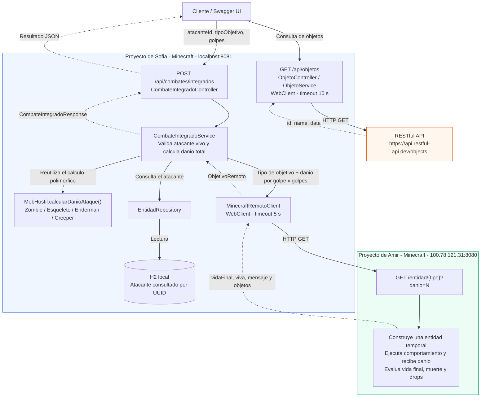
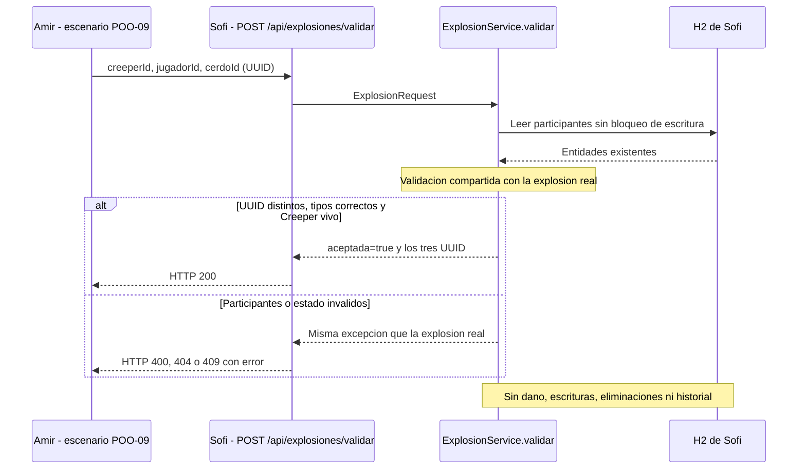

# Diagrama de integraciones de Minecraft

El proyecto de Sofia coordina una demolicion con **Nico** y **Amir**. Tambien
integra sus reglas de ataque con el proyecto Minecraft de
**Amir**, disponible en `http://100.78.121.31:8080`. Tambien consulta la API publica
de objetos de restful-api.dev.



Las flechas continuas muestran las llamadas y las punteadas, las respuestas.
La integracion de combate consulta H2 local y usa una demostracion temporal de
Amir; no escribe entidades persistidas en ninguno de los dos proyectos.
El comportamiento remoto se ejecuta antes de aplicar el danio solicitado; por
ejemplo, el Creeper temporal de Amir puede explotar durante ese comportamiento.

## Validacion de Sofi consumible por Amir como A2



Este endpoint de Sofi no hace llamadas salientes a Amir ni a Nico. Solo valida el
estado consultado; `POST /api/explosiones` sigue siendo la operacion con efectos.
Los UUID y respuestas esperadas estan en `docs/para-amir-validacion.txt`.

## Demolicion coordinada del trio

```mermaid
sequenceDiagram
    actor Usuario
    participant Sofi as Sofi - POST /api/demoliciones
    participant Nico as Nico - 100.83.179.97:8080
    participant Amir as Amir - 100.78.121.31:8080
    participant H2 as H2 de Sofi
    Usuario->>Sofi: explosivoNicoId (UUID), creeperAmirId (Long)
    Sofi->>Nico: GET /api/minecraft/explosivos/{id}
    Nico-->>Sofi: puedeExplotar
    alt Nico autoriza y su respuesta es valida
        Sofi->>Amir: POST /api/lp3/explosiones/simular con creeperId
        Note over Amir: Aplica dano real y elimina el Creeper emisor
        alt Amir confirma HTTP 200 y resultado valido
            Amir-->>Sofi: radio, creeper, objetivos
            Sofi->>H2: Guardar demolicion confirmada
            H2-->>Sofi: UUID local y fecha
            Sofi-->>Usuario: HTTP 201 y resultado registrado
        else Rechazo, error o respuesta incierta de Amir
            Sofi-->>Usuario: Error identificado; sin registro local
        end
    else Nico no autoriza o no puede evaluarse
        Sofi-->>Usuario: Error identificado; no llama a Amir
    end
```

Nico evalua un explosivo propio y Amir ejecuta la explosion de otro Creeper
propio; sus identificadores no representan la misma entidad. La decision de
Sofi exige ambas aceptaciones y guarda unicamente las demoliciones confirmadas.
El historial se consulta mediante `GET /api/demoliciones` y
`GET /api/demoliciones/{id}`, sin llamadas a los companeros.

Si falla H2 despues de la confirmacion de Amir, Sofi devuelve HTTP 503. Si vence
el timeout o la respuesta de Amir no se puede confirmar, no se puede asegurar
que la explosion no haya ocurrido. No hay rollback remoto ni reintentos
automaticos; el resultado debe verificarse antes de repetir la operacion.

## Reglas que aporta cada proyecto al combate temporal

| Proyecto | Responsabilidad |
| --- | --- |
| Sofia | Busca el atacante local por UUID y valida que sea un mob hostil vivo. |
| Sofia | Calcula el ataque con la misma logica que `atacarObjetivo`: Zombie 4; Esqueleto con arco 4, sin arco 2; Enderman 7; Creeper 0 para el ataque directo. |
| Sofia | Multiplica el danio por los golpes, consulta a Amir con WebClient y combina los resultados. |
| Amir | Construye el objetivo temporal y ejecuta sus reglas de comportamiento y recepcion de danio. |
| Amir | Devuelve vida final, supervivencia, mensaje y objetos que puede soltar al morir. |

La explosion local del Creeper sigue siendo una operacion independiente en
`POST /api/explosiones` y conserva sus propias reglas.

## Ejemplo de la integracion con Amir

```json
{
  "atacanteId": "11111111-1111-1111-1111-111111111111",
  "tipoObjetivo": "ZOMBIE",
  "golpes": 5
}
```

El Zombie local calcula `4 x 5 = 20` de danio. El Zombie temporal de Amir termina
con vida `0`, `viva=false` y suelta `carne_podrida`. El UUID del ejemplo debe
corresponder a un Zombie vivo de la base local.

## Referencias

| Integracion | Documentacion | Configuracion |
| --- | --- | --- |
| API de Sofia | [Swagger UI local](http://localhost:8081/swagger-ui.html) | `server.port=8081` |
| Proyecto de Nico | [Swagger UI de Nico](http://100.83.179.97:8080/swagger-ui/index.html), [OpenAPI de Nico](http://100.83.179.97:8080/v3/api-docs) | `nico.base-url`, `nico.timeout` |
| Proyecto de Amir | [Swagger UI de Amir](http://100.78.121.31:8080/swagger-ui/index.html), [OpenAPI de Amir](http://100.78.121.31:8080/v3/api-docs) | `minecraft-remoto.base-url`, `minecraft-remoto.timeout` |
| API de objetos | [Endpoint de objetos](https://api.restful-api.dev/objects) | `restful-api.base-url`, `restful-api.timeout` |

La configuracion esta en `src/main/resources/application.properties`. Los
errores de conexion o de respuesta remota se informan como HTTP 502 y los tiempos
de espera agotados, como HTTP 504.
